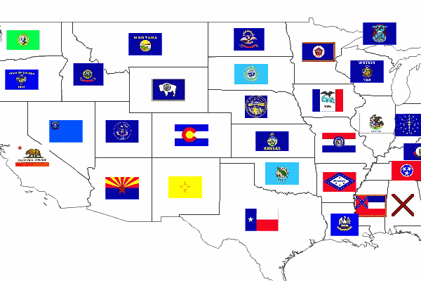

When [GeoServer 1.7.0](https://web.archive.org/web/20081208/http://geoserver.org/display/GEOS/GeoServer+1.7.0) was released in October of 2008, it included some new features that many people might find useful.  One of those new features is support for **dynamic symbolizers.**

Dynamic symbolizers, which originated from a [GeoTools styling subsystem improvement](https://web.archive.org/web/20081208/http://geotools.codehaus.org/Dynamic+SLD+Graphic+objects) from this past summer, allows you to do three things:

	
  * Create external references that contain feature attributes as variables__

	
  * Use decorative true type fonts as markers in your map

	
  * Program your own dynamic symbolizer to extend existing ones, with full access to all of the current feature attributes

In this post we'll cover the first item, and in the next post we'll consider the other two.

**Dynamic Symbolizers With External References**

Say you want to make a map of the USA that shows each state's flag superimposed on the state.  (You can use the _topp:states_ layer, which comes standard with GeoServer.)  With the old symbolizer approach, you would have to do two things:

	
  * Find all the flags as images, possibly as small PNG/GIF images.

	
  * Write a different rule for each state, connecting each state with its respective flag.

Now, having to find the flags is a challenge, but it can be done.   [This site](http://www.usautoparts.net/bmw/media/icons/states.htm), for example, has small flag graphics in JPEG format. The really time-consuming part is writing 50 different rules, each matching a state with its flag.

If we look closely at the image names, we can see a pattern.  The file names are all of the form:

tn_<StateAbbreviation>.jpg

And we happen to have the same state abbreviations in the STATE_ABBR attribute. Wouldn’t it be great if we could just link the attribute to the external graphics link?

With dynamic symbolizers, this can be done. You can embed [CQL](https://web.archive.org/web/20081208/http://geotools.codehaus.org/CQL+Parser+Design) (Common Query Language) expressions inside a external graphics link or inside a well-known mark name, and have the expression be expanded dynamically.  To embed a CQL expression, all you have to do is to type it between the brackets in this form:  ${ }.

Let’s apply this to our case. The external graphics link might originally look like:

<blockquote>

>     
>     <ExternalGraphic>
>        <OnlineResource xlink:type="simple" xlink:href="http://www.usautoparts.net/bmw/images/states/tn_${STATE_ABBR}.jpg"/>
>        <Format>image/gif</Format>
>     </ExternalGraphic>
> 
> 
</blockquote>

Note the file name:  tn_${STATE_ABBR}.jpg.  For each feature, the attribute name will be expanded, generating a different link for every feature. Unfortunately, that’s still not good enough, because the abbreviations are upper case, and the site links are case-sensitive and require lower case names. However, as we mentioned above, you can leverage the full power of CQL expressions in the dynamic symbolizer elements.  In this case, we can use the strToLowerCase function to change the values of our attributes to lower case.  With that, we have an instant flag map.

Here is the full SLD to generate this at home.

    
    <?xml version="1.0" encoding="ISO-8859-1"?>
    <StyledLayerDescriptor version="1.0.0"
      xmlns="http://www.opengis.net/sld"
      xmlns:ogc="http://www.opengis.net/ogc"
      xmlns:xlink="http://www.w3.org/1999/xlink"
      xmlns:xsi="http://www.w3.org/2001/XMLSchema-instance"
      xsi:schemaLocation="http://www.opengis.net/sld
                          http://schemas.opengis.net/sld/1.0.0/StyledLayerDescriptor.xsd">
      <NamedLayer>
        <Name>Default Polygon</Name>
        <UserStyle>
          <Title>Flags of USA</Title>
          <FeatureTypeStyle>
            <Rule>
              <Name>Solid black outline</Name>
              <LineSymbolizer>
                <Stroke/>
              </LineSymbolizer>
            </Rule>
          </FeatureTypeStyle>
          <FeatureTypeStyle>
            <Rule>
              <Name>Flags</Name>
              <Title>USA state flags</Title>
              <PointSymbolizer>
                <Graphic>
                  <ExternalGraphic>
                    <OnlineResource xlink:type="simple"
                      xlink:href="http://www.usautoparts.net/bmw/images/states/tn_${strToLowerCase(STATE_ABBR)}.jpg" />
                    <Format>image/gif</Format>
                  </ExternalGraphic>
                </Graphic>
              </PointSymbolizer>
            </Rule>
          </FeatureTypeStyle>
        </UserStyle>
      </NamedLayer>
    </StyledLayerDescriptor>
