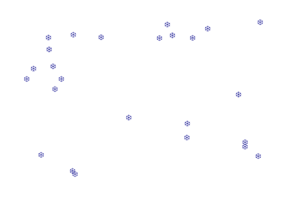

In our [previous post on dynamic symbolizers](http://blog.geoserver.org/2008/12/08/dynamic-symbolizers-part-1/), we saw how we can generate dynamic external symbolizers based on feature attributes using only a simple style (SLD).

Today we'll see two other features of dynamic symbolizers, namely:

	
  * using decorative TrueType fonts as markers in your map

	
  * Programing your own dynamic symbolizer to extend existing ones, with full access to the current feature attributes

## Using decorative True Type fonts as markers

As you may already know, the internet is filled with these funny [dingbat](http://en.wikipedia.org/wiki/Dingbat) TrueType (TTF) files that do not contain a recognizable font, but instead include a set of symbols. If you are a Windows user, you should be familiar with the [Wingdings](http://en.wikipedia.org/wiki/Wingdings) font.

Some commercial GIS software use characters in these fonts as point markers, so it’s no surprise that you can find some TTF fonts with cartographic symbols embedded.

As standard, you can use font characters by leveraging the **TextSymbolizer**.  You can specify a font (say, Wingdings), and then a specific character (or characters) to serve as a point. This works, but has two flaws:

	
  1. Since the markers are labels, not points, they are subject to "conflict resolution."  Multiple overlapping labels are discarded in favor of a single label.  This means that not all points will necessarily be displayed.

	
  2. You are restricted to choosing the just the fill color of the marker (like a normal character).

Dynamic symbolizers come to the rescue again.  With dynamic symbolizers, you can use a character in a font as a **PointSymbolizer**.  The syntax for this is specified as:

ttf://FontName#code

Say, for example, that you would like the snowflake symbol from the Wingdings font as a marker in your map. You fire up the Windows _charmap_ utility (the GNOME Character Map program works as well) and learn that the snowflake code is 0x54. (Actually, the code, is in fact 0x**F0**54 (prefix the code with F0).

So your snowflake mark may look like:

    
    <Mark>
      <WellKnownName>ttf://Wingdings#0xF054</WellKnownName>
      <Fill>
        <CssParameter name="fill">#000088</CssParameter>
      </Fill>
    </Mark>

Here is the sample layer sf:archsites drawn with the above mark, and the full SLD.  Notice that the points that overlap are all shown, which would not have happened using a standard TextSymbolizer.

    
    <?xml version="1.0" encoding="ISO-8859-1"?>
    <StyledLayerDescriptor version="1.0.0" xmlns="http://www.opengis.net/sld" xmlns:ogc="http://www.opengis.net/ogc"
      xmlns:xlink="http://www.w3.org/1999/xlink" xmlns:xsi="http://www.w3.org/2001/XMLSchema-instance"
      xsi:schemaLocation="http://www.opengis.net/sld http://schemas.opengis.net/sld/1.0.0/StyledLayerDescriptor.xsd">
      <NamedLayer>
        <Name>Snow symbol</Name>
        <UserStyle>
          <Title>Snow symbol</Title>
          <Abstract>Marks each point with a snow symbol</Abstract>
    
          <FeatureTypeStyle>
            <Rule>
              <Title>Red square</Title>
              <PointSymbolizer>
                <Graphic>
                  <Mark>
                    <WellKnownName>ttf://Wingdings#0xF054</WellKnownName>
                    <Fill>
                      <CssParameter name="fill">#000088</CssParameter>
                    </Fill>
                  </Mark>
                  <Size>12</Size>
                </Graphic>
              </PointSymbolizer>
            </Rule>
    
          </FeatureTypeStyle>
        </UserStyle>
      </NamedLayer>
    </StyledLayerDescriptor>

Using a TTF character as a PointSymbolizer has another advantage:  you can specify both the fill (inside) color and stroke (outside) color separately.

As we've seen before, you also have the option to embed CQL expressions inside the well known name. For example, you could embed the symbol code into a feature attribute, and have _each feature use a different marker_ as a result!

## Not happy with the current symbolizer sets? Build your own!

If you’re not happy with the symbolizing capabilities you can now build your own and plug it into GeoServer as any other extensions.

For details of how this can be done have a look at the [dynamic symbolizer proposal](http://geotools.codehaus.org/Dynamic+SLD+Graphic+objects) in GeoTools, and see the sample [TTFMarkFactory](http://svn.geotools.org/branches/2.5.x/modules/library/render/src/main/java/org/geotools/renderer/style/TTFMarkFactory.java) as an example:

If you haven't yet employed dynamic symbolizers in your maps, now you have some reasons to do so.  Enjoy!
