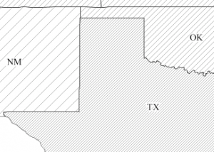
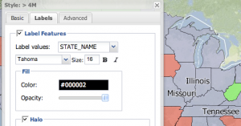

The GeoServer team would like to announce the release of GeoServer 1.7.2.  This release brings many exciting new features.

The first major improvement is label rendering. In version 1.7.1, GeoServer added support for [curved labeling]().  In this version, support is added for [wrapped labels](https://web.archive.org/web/20090126/http://geoserver.org/display/GEOSDOC/LabelingOptions#LabelingOptions-newlabel), which enables a label to span multiple lines. This feature affects the labeling of points and polygons.

Thanks to Andrea Aime for all the great labeling improvements.

Another new styling feature is support for [hatching](https://web.archive.org/web/20090126/http://geoserver.org/display/GEOSDOC/Hatching).  Among many other new designs, this allows **railroad styling** to be accomplished for the first time.  Also, polygon hatched fills can now be drawn, and GeoServer ships with a new style, `pophatch.sld`, that can be applied to the topp:states layer to see this in action.

The 1.7.2 release also brings some great new extensions. The [HTML imagemap extension](https://web.archive.org/web/20090126/http://geoserver.org/display/GEOS/HTML+ImageMap+support) ([download](https://sourceforge.net/projects/geoserver/files/GeoServer/1.7.2/extensions/geoserver-1.7.2-imagemap-plugin.zip/download)), contributed by Mauro Bartolomeoli, allows a user to add interactive features to a map without the use of Flash, SVG, or other dynamic content languages. You can check out the [imagemap extension in action](http://geo.openplans.org/states.html).  A special thanks to Mauro for the contribution.

The new and improved DB2 extension ([download](https://sourceforge.net/projects/geoserver/files/GeoServer/1.7.2/extensions/geoserver-1.7.2-db2ng-plugin.zip/download)), which allows connection with [IBM DB2 databases](http://www.ibm.com/db2) is based on the [GeoTools JDBC Next Generation](http://geotools.codehaus.org/JDBC+DataStore+-+NG) framework. The extension was contributed by Christian Müller, who is an active member of the [GeoTools](http://geotools.org) community. Special thanks to Christian.

The new [OGR extension](https://web.archive.org/web/20090126/http://geoserver.org/display/GEOS/Ogr2Ogr+based+WFS+output+format) ([download](https://sourceforge.net/projects/geoserver/files/GeoServer/1.7.2/extensions/geoserver-1.7.2-ogr-plugin.zip/download)) is based on the [GDAL/OGR](http://www.gdal.org/ogr/) library. The extension adds the ability to output from WFS any of the formats supported by OGR. OGR has a very diverse and comprehensive list of output formats, so this extension very much enhances the utility of the GeoServer WFS.

Improvements were also made to the [GeoExt styler extension](https://web.archive.org/web/20090126/http://geoserver.org/display/GEOS/GeoExt+Styler) ([download](https://sourceforge.net/projects/geoserver/files/GeoServer/1.7.2/extensions/styler-1.7.2.zip/download)), which is a new graphical interface for map styling initially released with GeoServer 1.7.1. Tim Schaub, Andreas Hocevar, and the rest of the [GeoExt](http://www.geoext.org) team have added support for labels to the styler application.

Thanks to the GeoExt team for this great improvement.

In addition, a total of [70 issues](#release-notes) were handled for 1.7.2.

Thanks to everyone who contributed features and bug reports for this release. We encourage you to download GeoServer 1.7.2, try it out, and let us know what you think. Comments and feedback are always welcome on the [mailing list](mailto:geoserver-users@lists.sourceforge.net), as the community is always interested to hear how people are using GeoServer. Stay tuned for the 1.7.3 release, slated for release in the next month, which will include improvements to [Geo Search](), and the official release of the REST configuration API.

----

## GeoServer 1.7.2

Released on January 25, 2009

#### Download format

- [Binary (OS independent)](https://sourceforge.net/projects/geoserver/files/GeoServer/1.7.2/geoserver-1.7.2-bin.zip/download)
- [Web Archive](https://sourceforge.net/projects/geoserver/files/GeoServer/1.7.2/geoserver-1.7.2-war.zip/download)
- [Windows Installer](https://sourceforge.net/projects/geoserver/files/GeoServer/1.7.2/geoserver-1.7.2.exe/download)
- [Mac OS X Installer](https://sourceforge.net/projects/geoserver/files/GeoServer/1.7.2/geoserver-1.7.2.dmg/download)
- [Source Code](https://sourceforge.net/projects/geoserver/files/GeoServer/1.7.2/geoserver-1.7.2-src.zip/download)

#### Documentation

- [Documentation (Site Export)](https://sourceforge.net/projects/geoserver/files/GeoServer/1.7.2/geoserver-1.7.2-doc.zip/download)
- [API Documentation](https://sourceforge.net/projects/geoserver/files/GeoServer/1.7.2/geoserver-1.7.2-javadoc.zip/download)
- [Release Notes](#release-notes)

#### Extensions

**Datastore**

- [ArcSDE](https://sourceforge.net/projects/geoserver/files/GeoServer/1.7.2/extensions/geoserver-1.7.2-arcsde-plugin.zip/download)
- [GML](https://sourceforge.net/projects/geoserver/files/GeoServer/1.7.2/extensions/geoserver-1.7.2-gml-plugin.zip/download)
- [DB2](https://sourceforge.net/projects/geoserver/files/GeoServer/1.7.2/extensions/geoserver-1.7.2-db2-plugin.zip/download)
- [DB2 (Next Generation)](https://sourceforge.net/projects/geoserver/files/GeoServer/1.7.2/extensions/geoserver-1.7.2-db2ng-plugin.zip/download)
- [H2](https://sourceforge.net/projects/geoserver/files/GeoServer/1.7.2/extensions/geoserver-1.7.2-h2-plugin.zip/download)
- [MySQL](https://sourceforge.net/projects/geoserver/files/GeoServer/1.7.2/extensions/geoserver-1.7.2-mysql-plugin.zip/download)
- [Oracle](https://sourceforge.net/projects/geoserver/files/GeoServer/1.7.2/extensions/geoserver-1.7.2-oracle-plugin.zip/download)
- [Oracle (Next Generation)](https://sourceforge.net/projects/geoserver/files/GeoServer/1.7.2/extensions/geoserver-1.7.2-oracleng-plugin.zip/download)
- [SQL Server](https://sourceforge.net/projects/geoserver/files/GeoServer/1.7.2/extensions/geoserver-1.7.2-sqlserver-plugin.zip/download)
- [VPF](https://sourceforge.net/projects/geoserver/files/GeoServer/1.7.2/extensions/geoserver-1.7.2-vpf-plugin.zip/download)

**Coveragestore**

- [GDAL](https://sourceforge.net/projects/geoserver/files/GeoServer/1.7.2/extensions/geoserver-1.7.2-gdal-plugin.zip/download)
- [Image Pyramid](https://sourceforge.net/projects/geoserver/files/GeoServer/1.7.2/extensions/geoserver-1.7.2-pyramid-plugin.zip/download)

**Other**

- [OGR Output Format](https://sourceforge.net/projects/geoserver/files/GeoServer/1.7.2/extensions/geoserver-1.7.2-ogr-plugin.zip/download)
- [WFS Versioning](https://sourceforge.net/projects/geoserver/files/GeoServer/1.7.2/extensions/geoserver-1.7.2-wfsv-plugin.zip/download)
- [REST](https://sourceforge.net/projects/geoserver/files/GeoServer/1.7.2/extensions/geoserver-1.7.2-rest-plugin.zip/download)
- [GeoExt Styler](https://sourceforge.net/projects/geoserver/files/GeoServer/1.7.2/extensions/styler-1.7.2.zip/download)
- [Image Map](https://sourceforge.net/projects/geoserver/files/GeoServer/1.7.2/extensions/geoserver-1.7.2-imagemap-plugin.zip/download)
- [GeoSearch](https://sourceforge.net/projects/geoserver/files/GeoServer/1.7.2/extensions/geoserver-1.7.2-geosearch-plugin.zip/download)

#### GeoServer on [SourceForge](https://sourceforge.net/projects/geoserver/files/GeoServer/1.7.2/).

SourceForge Release 655336.

## Release notes

New Feature:

* [GEOS-665](https://osgeo-org.atlassian.net/browse/GEOS-665) ogr2ogr for new WFS output formats
* [GEOS-1406](https://osgeo-org.atlassian.net/browse/GEOS-1406) HTMLImageMap GetMapProducer Proposal
* [GEOS-2386](https://osgeo-org.atlassian.net/browse/GEOS-2386) Have FeatureBounding affect the feature collection bounds as well
* [GEOS-2433](https://osgeo-org.atlassian.net/browse/GEOS-2433) add db2-ng as datastore extension
* [GEOS-2508](https://osgeo-org.atlassian.net/browse/GEOS-2508) REST configuration of new source without actually either uploading or moving files around
* [GEOS-2534](https://osgeo-org.atlassian.net/browse/GEOS-2534) Non-cached Virtual Earth and Google Maps support through GWC
* [GEOS-2548](https://osgeo-org.atlassian.net/browse/GEOS-2548) Better support for hatched fills
* [GEOS-2573](https://osgeo-org.atlassian.net/browse/GEOS-2573) HTML ImageMap extension

Improvement:

* [GEOS-2201](https://osgeo-org.atlassian.net/browse/GEOS-2201) Allow shapefile export to deal with mixed but compatible geometry types (e.g. points+multipoints)
* [GEOS-2245](https://osgeo-org.atlassian.net/browse/GEOS-2245) Disable tile recyclying in the jai config for the release data dir
* [GEOS-2423](https://osgeo-org.atlassian.net/browse/GEOS-2423) Allow freemarker templates to access to FeatureType metadata
* [GEOS-2448](https://osgeo-org.atlassian.net/browse/GEOS-2448) kml vector transformer stores all fid's from a dataset in memory
* [GEOS-2467](https://osgeo-org.atlassian.net/browse/GEOS-2467) KML Reflector should not use superoverlays when regionating does not work.
* [GEOS-2482](https://osgeo-org.atlassian.net/browse/GEOS-2482) Better error message when a mandatory parameter is missing in WMS GetMap request
* [GEOS-2503](https://osgeo-org.atlassian.net/browse/GEOS-2503) Better error message when a mandatory parameter is missing in WMS GetLegendGraphic request
* [GEOS-2511](https://osgeo-org.atlassian.net/browse/GEOS-2511) Let users choose field for KML name element through the configuration interface
* [GEOS-2529](https://osgeo-org.atlassian.net/browse/GEOS-2529) REST CoverageListResource improvement
* [GEOS-2531](https://osgeo-org.atlassian.net/browse/GEOS-2531) REST CoverageResource improvement
* [GEOS-2557](https://osgeo-org.atlassian.net/browse/GEOS-2557) Have file publisher redirect directory references to a default file
* [GEOS-2563](https://osgeo-org.atlassian.net/browse/GEOS-2563) Push the IOUtils test utility class into the main source code and share directory and zip handling into it

Bug:

* [GEOS-1189](https://osgeo-org.atlassian.net/browse/GEOS-1189) hook up featureBounding parameter to gml3 encoder
* [GEOS-1569](https://osgeo-org.atlassian.net/browse/GEOS-1569) Spatial index on shapefiles is not built when accessing data with shapefile renderer
* [GEOS-1711](https://osgeo-org.atlassian.net/browse/GEOS-1711) WCS metadata link types use the wrong type
* [GEOS-1798](https://osgeo-org.atlassian.net/browse/GEOS-1798) WFSV transaction rollback does not work with wfs 1.0
* [GEOS-1862](https://osgeo-org.atlassian.net/browse/GEOS-1862) Parsing failed for tr5_72ha: java.lang.StringIndexOutOfBoundsException: String index out of range: 0
* [GEOS-2035](https://osgeo-org.atlassian.net/browse/GEOS-2035) GeoRSS encoder does not support multi{polygon, point, line} geometries.
* [GEOS-2039](https://osgeo-org.atlassian.net/browse/GEOS-2039) Invalid FID filter results in invalid query, should result in an emtpy feature collection instead
* [GEOS-2097](https://osgeo-org.atlassian.net/browse/GEOS-2097) LEGEND_OPTIONS:  forceLabels doesn't work
* [GEOS-2247](https://osgeo-org.atlassian.net/browse/GEOS-2247) dynamic rotation a label do not show on image
* [GEOS-2251](https://osgeo-org.atlassian.net/browse/GEOS-2251) Database backed datastores fail to honour the matchCase attribute
* [GEOS-2252](https://osgeo-org.atlassian.net/browse/GEOS-2252) GetFeature output does not honor "feature bounding" setting in wfs
* [GEOS-2276](https://osgeo-org.atlassian.net/browse/GEOS-2276) gml3 encoder does not handle GeometryCollections
* [GEOS-2278](https://osgeo-org.atlassian.net/browse/GEOS-2278) datastore disposal with regard to connection pools
* [GEOS-2401](https://osgeo-org.atlassian.net/browse/GEOS-2401) DescribeFeatureType fails when namespace mapping missing on request
* [GEOS-2436](https://osgeo-org.atlassian.net/browse/GEOS-2436) Images in REST About Layer page obscured
* [GEOS-2441](https://osgeo-org.atlassian.net/browse/GEOS-2441) styles not reloaded from disk on load
* [GEOS-2443](https://osgeo-org.atlassian.net/browse/GEOS-2443) Graphic Fill has no effect in Google Earth
* [GEOS-2460](https://osgeo-org.atlassian.net/browse/GEOS-2460) WFS 1.1 capabilities missing extra output format  and vendor specific params
* [GEOS-2461](https://osgeo-org.atlassian.net/browse/GEOS-2461) Default WFS outputFormat stated as text/gml; subtype=gml/3.1.1 instead of text/xml; subtype=gml/3.1.1
* [GEOS-2462](https://osgeo-org.atlassian.net/browse/GEOS-2462) Release mosaic test data has worng config
* [GEOS-2464](https://osgeo-org.atlassian.net/browse/GEOS-2464) Filters are not passed to remote layers
* [GEOS-2469](https://osgeo-org.atlassian.net/browse/GEOS-2469) An attribute named "fid" masks the fid in freemarker templates
* [GEOS-2475](https://osgeo-org.atlassian.net/browse/GEOS-2475) KML reflector fails to return proper GroundOverlay with raster layer in flat mode
* [GEOS-2499](https://osgeo-org.atlassian.net/browse/GEOS-2499) Geometry attributes fail to be recognized if the postgis metadata tables cannot be accessed
* [GEOS-2505](https://osgeo-org.atlassian.net/browse/GEOS-2505) KML Feature Limit not respected
* [GEOS-2510](https://osgeo-org.atlassian.net/browse/GEOS-2510) "About" page has incorrect KML output
* [GEOS-2518](https://osgeo-org.atlassian.net/browse/GEOS-2518) GetFeatureInfo dies dies with raster with multiple bands with the same name
* [GEOS-2525](https://osgeo-org.atlassian.net/browse/GEOS-2525) TTF markers are drawn upside down!
* [GEOS-2526](https://osgeo-org.atlassian.net/browse/GEOS-2526) No KML output when Oracle datasource
* [GEOS-2535](https://osgeo-org.atlassian.net/browse/GEOS-2535) KML description template does not handle the empty case gracefully
* [GEOS-2537](https://osgeo-org.atlassian.net/browse/GEOS-2537) Escape string problem
* [GEOS-2539](https://osgeo-org.atlassian.net/browse/GEOS-2539) Avoding doing class.forName repeatedly in order to support pluggable versioning
* [GEOS-2540](https://osgeo-org.atlassian.net/browse/GEOS-2540) A misconfigured datastore prevents whole WFS to work
* [GEOS-2543](https://osgeo-org.atlassian.net/browse/GEOS-2543) Most versioning operations don't work anymore
* [GEOS-2546](https://osgeo-org.atlassian.net/browse/GEOS-2546) RESTConfig shapefile upload fails
* [GEOS-2547](https://osgeo-org.atlassian.net/browse/GEOS-2547) NullPointerException on ReverseProxyFilter if running on the embedded Jetty
* [GEOS-2553](https://osgeo-org.atlassian.net/browse/GEOS-2553) Acecssing http://localhost:8080/geoserver redirects to a non existent path
* [GEOS-2554](https://osgeo-org.atlassian.net/browse/GEOS-2554) Improper error message reported when service is disabled
* [GEOS-2558](https://osgeo-org.atlassian.net/browse/GEOS-2558) A layer referring to a missing style makes wms caps generation fail silently
* [GEOS-2560](https://osgeo-org.atlassian.net/browse/GEOS-2560) Make sure the new labeller is used also by the non raster renderers
* [GEOS-2561](https://osgeo-org.atlassian.net/browse/GEOS-2561) NG labeller does not rotate labels around the anchor point
* [GEOS-2570](https://osgeo-org.atlassian.net/browse/GEOS-2570) Can't create a coverage store for an arcsde raster
* [GEOS-2574](https://osgeo-org.atlassian.net/browse/GEOS-2574) GetFeatureTypeInfo fails on raster data

Task:

* [GEOS-2180](https://osgeo-org.atlassian.net/browse/GEOS-2180) Style and group fixes in the release configuration
* [GEOS-2458](https://osgeo-org.atlassian.net/browse/GEOS-2458) Upgrade commons-logging to 1.1.1
* [GEOS-2507](https://osgeo-org.atlassian.net/browse/GEOS-2507) TextSymbolizer + plate does not pass the schema validation
* [GEOS-2509](https://osgeo-org.atlassian.net/browse/GEOS-2509) upgrade h2 version

Wish:

* [GEOS-361](https://osgeo-org.atlassian.net/browse/GEOS-361) Titles are human friendly
* [GEOS-1783](https://osgeo-org.atlassian.net/browse/GEOS-1783) override an existing EPSG definition in the property file
