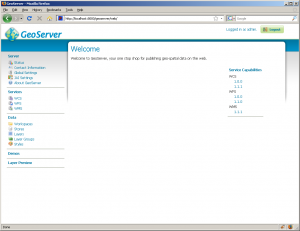
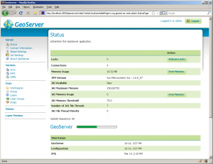
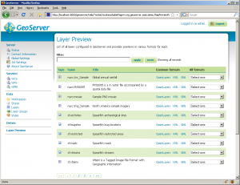
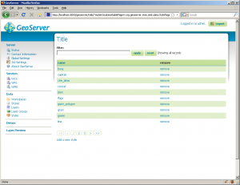

I am happy to announce to everyone a sneak peak of the future of GeoServer.  Behold the newest alpha release of GeoServer 2.0.

I [first mentioned GeoServer 2.0 last August]() when the first alpha was released, but much work has been done since then.  The most obvious and exciting new feature in GeoServer 2.0 is the [new UI](https://web.archive.org/web/20090420/http://geoserver.org/display/GEOS/GSIP+23+-+Wicket+UI), based on the [Wicket](http://wicket.apache.org) framework.  The UI has been totally redesigned and updated to provide a greatly improved user experience.  Take a look at some screenshots:

Front page

Status

Layer preview

Styles

Another happy announcement is a major workflow change for data configuration.  The **Submit -> Apply -> Save** workflow, often bemoaned by users, has been eliminated, in favor of a simpler **Save changes** workflow, with changes automatically persisting.  To me, that's a 66.6% reduction in button clicks!

**This is an alpha release** (the most recent stable version remains at [1.7.3](https://web.archive.org/web/20090420/http://geoserver.org/display/GEOS/GeoServer+1.7.3))  and so it comes with a few caveats.  It's very new code, and not fully tested, so please don't run it in a production environment.  Features may also be likely to change as the code approaches stability.  Also, running GeoServer 2.0 with an existing data directory will alter it such that it will become incompatible with existing stable versions.  We have instructions on [how to migrate back to 1.7.x](https://web.archive.org/web/20090420/http://geoserver.org/display/GEOSDOC/Migrating+Between+1.7.x+and+2.0.x), but it might be better to use the built-in data directory for now, or at least to back up your existing data directory first.

That said, we want everyone to download, try it out, and provide feedback, since it was partly in response to user feedback that the GeoServer Team upgraded the user environment.  I hope you enjoy!

----

## GeoServer 2.0-alpha2

Released on April 15, 2009

#### Download format

- [Binary (OS independent)](https://sourceforge.net/projects/geoserver/files/GeoServer/2.0-alpha2/geoserver-2.0-alpha2-bin.zip/download)
- [Web Archive](https://sourceforge.net/projects/geoserver/files/GeoServer/2.0-alpha2/geoserver-2.0-alpha2-war.zip/download)
- [Windows Installer](https://sourceforge.net/projects/geoserver/files/GeoServer/2.0-alpha2/geoserver-2.0-alpha2.exe/download)
- [Mac OS X Installer](https://sourceforge.net/projects/geoserver/files/GeoServer/2.0-alpha2/geoserver-2.0-alpha2.dmg/download)
- [Source Code](https://sourceforge.net/projects/geoserver/files/GeoServer/2.0-alpha2/geoserver-2.0-alpha2-src.zip/download)

#### Documentation

- [API Documentation](https://sourceforge.net/projects/geoserver/files/GeoServer/2.0-alpha2/geoserver-2.0-alpha2-javadoc.zip/download)
- [Release Notes](#release-notes)

#### Extensions

**Datastore**

- [ArcSDE](https://sourceforge.net/projects/geoserver/files/GeoServer/2.0-alpha2/extensions/geoserver-2.0-alpha2-arcsde-plugin.zip/download)
- [H2](https://sourceforge.net/projects/geoserver/files/GeoServer/2.0-alpha2/extensions/geoserver-2.0-alpha2-h2-plugin.zip/download)
- [Oracle](https://sourceforge.net/projects/geoserver/files/GeoServer/2.0-alpha2/extensions/geoserver-2.0-alpha2-oracle-plugin.zip/download)

**Coveragestore**

**Other**

- [Excel Output Format](https://sourceforge.net/projects/geoserver/files/GeoServer/2.0-alpha2/extensions/geoserver-2.0-alpha2-excel-plugin.zip/download)
- [Image Map](https://sourceforge.net/projects/geoserver/files/GeoServer/2.0-alpha2/extensions/geoserver-2.0-alpha2-imagemap-plugin.zip/download)
- [OGR Output Format](https://sourceforge.net/projects/geoserver/files/GeoServer/2.0-alpha2/extensions/geoserver-2.0-alpha2-ogr-plugin.zip/download)
- [WFS Versioning](https://sourceforge.net/projects/geoserver/files/GeoServer/2.0-alpha2/extensions/geoserver-2.0-alpha2-wfsv-plugin.zip/download)

#### [SourceForge](https://sourceforge.net/projects/geoserver/files/GeoServer/2.0-alpha2/)

SourceForge Release 676086.

#### [JIRA](https://osgeo-org.atlassian.net/issues/?jql=project%3DGEOS)

JIRA Version 15211

## Release notes

Improvement:

* [GEOS-2765](https://osgeo-org.atlassian.net/browse/GEOS-2765) Factor out reusable component from StorePage
* [GEOS-2799](https://osgeo-org.atlassian.net/browse/GEOS-2799) Catalog and configuration should use auto generated ids for catalog objects, not names

Bug:

* [GEOS-2872](https://osgeo-org.atlassian.net/browse/GEOS-2872) Wicket UI is missing schemas inside the webapp
* [GEOS-2873](https://osgeo-org.atlassian.net/browse/GEOS-2873) NPE generating wms caps when restarting the converted WMS 1.1 data dir
* [GEOS-2874](https://osgeo-org.atlassian.net/browse/GEOS-2874) GetMap request with multiple layers and no specified styles use the style of the first layer for all layers
* [GEOS-2876](https://osgeo-org.atlassian.net/browse/GEOS-2876) LegacyExceptionHanlder computes a wrong schema base, thus generates a wrong dtd reference
* [GEOS-2880](https://osgeo-org.atlassian.net/browse/GEOS-2880) GML2OutputFormat creates a back referecen to DescribeFeatureType that does not include the namespace prefix in the typeName

Task:

* [GEOS-2134](https://osgeo-org.atlassian.net/browse/GEOS-2134) Bring the new UI to feature parity with the old UI
* [GEOS-2143](https://osgeo-org.atlassian.net/browse/GEOS-2143) Demo Requests
* [GEOS-2711](https://osgeo-org.atlassian.net/browse/GEOS-2711) New data directory and persistence structure
* [GEOS-2898](https://osgeo-org.atlassian.net/browse/GEOS-2898) Create page about data directory changes when going between 1.7.x and 2.0.x

Sub-task:

* [GEOS-2146](https://osgeo-org.atlassian.net/browse/GEOS-2146) WFS-T Demo
* [GEOS-2147](https://osgeo-org.atlassian.net/browse/GEOS-2147) Overlay on Google Maps Demo
* [GEOS-2721](https://osgeo-org.atlassian.net/browse/GEOS-2721) Layer Group Configuration
