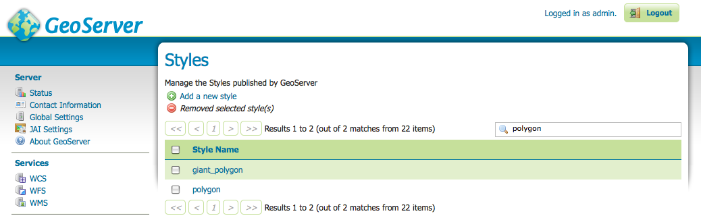

The GeoServer Team is happy to announce GeoServer 2.0-beta1, the first beta release of the 2.0 series.

The primary focus of version 2.0 is the **new user interface**.  This interface addresses many suggestions for usability improvements, including paging and filtering of lists of information, batch removal of layers, and the elimination of the Submit-Apply-Save workflow.

Another particularly useful feature added since [alpha2]() was released is **cascading delete**. This feature allows a user to remove a workspace or a data store and have all the entities contained inside (such as layers) also be removed.  Previously, it was necessary to delete all layers individually before being able to remove a data store.  To prevent unintended deletion, a confirmation page details what will be removed.

As usual a host of other [fixes and improvements](#release-notes) (over 100!) have also been incorporated into this release. Please download, give it a try, and forward your feedback along.  We greatly appreciate reporting issues to the [users mailing list](mailto:geoserver-users@lists.sourceforge.net) and look forward to general feedback on the new user interface.

----

## GeoServer 2.0-beta1

Released on May 25, 2009

#### Download format

- [Binary (OS independent)](https://sourceforge.net/projects/geoserver/files/GeoServer/2.0-beta1/geoserver-2.0-beta1-bin.zip/download)
- [Web Archive](https://sourceforge.net/projects/geoserver/files/GeoServer/2.0-beta1/geoserver-2.0-beta1-war.zip/download)
- [Windows Installer](https://sourceforge.net/projects/geoserver/files/GeoServer/2.0-beta1/geoserver-2.0-beta1.exe/download)
- [Mac OS X Installer](https://sourceforge.net/projects/geoserver/files/GeoServer/2.0-beta1/geoserver-2.0-beta1.dmg/download)
- [Source Code](https://sourceforge.net/projects/geoserver/files/GeoServer/2.0-beta1/geoserver-2.0-beta1-src.zip/download)

#### Documentation

- [API Documentation](https://sourceforge.net/projects/geoserver/files/GeoServer/2.0-beta1/geoserver-2.0-beta1-javadoc.zip/download)
- [Release Notes](#release-notes)

#### Extensions

**Datastore**

- [ArcSDE](https://sourceforge.net/projects/geoserver/files/GeoServer/2.0-beta1/extensions/geoserver-2.0-beta1-arcsde-plugin.zip/download)
- [DB2](https://sourceforge.net/projects/geoserver/files/GeoServer/2.0-beta1/extensions/geoserver-2.0-beta1-db2-plugin.zip/download)
- [H2](https://sourceforge.net/projects/geoserver/files/GeoServer/2.0-beta1/extensions/geoserver-2.0-beta1-h2-plugin.zip/download)
- [MySQL](https://sourceforge.net/projects/geoserver/files/GeoServer/2.0-beta1/extensions/geoserver-2.0-beta1-mysql-plugin.zip/download)
- [Oracle](https://sourceforge.net/projects/geoserver/files/GeoServer/2.0-beta1/extensions/geoserver-2.0-beta1-oracle-plugin.zip/download)

**Coveragestore**

- [GDAL](https://sourceforge.net/projects/geoserver/files/GeoServer/2.0-beta1/extensions/geoserver-2.0-beta1-gdal-plugin.zip/download)
- [Image Pyramid](https://sourceforge.net/projects/geoserver/files/GeoServer/2.0-beta1/extensions/geoserver-2.0-beta1-pyramid-plugin.zip/download)

**Other**

- [OGR Output Format](https://sourceforge.net/projects/geoserver/files/GeoServer/2.0-beta1/extensions/geoserver-2.0-beta1-ogr-plugin.zip/download)
- [WFS Versioning](https://sourceforge.net/projects/geoserver/files/GeoServer/2.0-beta1/extensions/geoserver-2.0-beta1-wfsv-plugin.zip/download)
- [Image Map](https://sourceforge.net/projects/geoserver/files/GeoServer/2.0-beta1/extensions/geoserver-2.0-beta1-imagemap-plugin.zip/download)

#### [SourceForge](https://sourceforge.net/projects/geoserver/files/GeoServer/2.0-beta1/)

SourceForge Release 685066.

#### [JIRA](https://osgeo-org.atlassian.net/issues/?jql=project%3DGEOS)

JIRA Version 15082

## Release notes

New Feature:

* [GEOS-2815](https://osgeo-org.atlassian.net/browse/GEOS-2815) WMS Decoration Layout
* [GEOS-2944](https://osgeo-org.atlassian.net/browse/GEOS-2944) Batch remove in the Wicket UI

Improvement:

* [GEOS-2697](https://osgeo-org.atlassian.net/browse/GEOS-2697) Factor out "sortable filterable table" code in a few reusable classes
* [GEOS-2758](https://osgeo-org.atlassian.net/browse/GEOS-2758) have WicketTestApplication be capable of finding keys defined in the root GeoServerApplication.properties file
* [GEOS-2759](https://osgeo-org.atlassian.net/browse/GEOS-2759) Factory out SRSList demo into reusable component.
* [GEOS-2834](https://osgeo-org.atlassian.net/browse/GEOS-2834) Implement a visitor for catalog objects
* [GEOS-2835](https://osgeo-org.atlassian.net/browse/GEOS-2835) Create a root interface for Catalog objects
* [GEOS-2894](https://osgeo-org.atlassian.net/browse/GEOS-2894) Move actions above tables
* [GEOS-2896](https://osgeo-org.atlassian.net/browse/GEOS-2896) Capitalize all table headings
* [GEOS-2897](https://osgeo-org.atlassian.net/browse/GEOS-2897) Add pagination to top and bottom of tables
* [GEOS-2899](https://osgeo-org.atlassian.net/browse/GEOS-2899) Make consistent and better use of icons
* [GEOS-2900](https://osgeo-org.atlassian.net/browse/GEOS-2900) Replace table columns titled "name" with something more descriptive
* [GEOS-2901](https://osgeo-org.atlassian.net/browse/GEOS-2901) Replace "type" with icons
* [GEOS-2903](https://osgeo-org.atlassian.net/browse/GEOS-2903) Table filtering improvements
* [GEOS-2904](https://osgeo-org.atlassian.net/browse/GEOS-2904) Move number of results to be inline with the paging controls
* [GEOS-2943](https://osgeo-org.atlassian.net/browse/GEOS-2943) Have 25 results per page instead of 10
* [GEOS-2977](https://osgeo-org.atlassian.net/browse/GEOS-2977) Make GeoServerTablePanel searches case insensitive
* [GEOS-3039](https://osgeo-org.atlassian.net/browse/GEOS-3039) Speed up i18n string lookup

Bug:

* [GEOS-2670](https://osgeo-org.atlassian.net/browse/GEOS-2670) Dynamic symbolizers not evaluated in KML output
* [GEOS-2762](https://osgeo-org.atlassian.net/browse/GEOS-2762) Wicket UI is not using the proper favicon
* [GEOS-2796](https://osgeo-org.atlassian.net/browse/GEOS-2796) Can't reload the stored configuration after restart on trunk
* [GEOS-2798](https://osgeo-org.atlassian.net/browse/GEOS-2798) Stores are not reloaded when a connection parameter changes
* [GEOS-2800](https://osgeo-org.atlassian.net/browse/GEOS-2800) resource pool caches datastores by name
* [GEOS-2845](https://osgeo-org.atlassian.net/browse/GEOS-2845) SRS list page should behave like other list pages
* [GEOS-2850](https://osgeo-org.atlassian.net/browse/GEOS-2850) Layer Preview page makes the GetMap request with the native CRS but WGS84 coords
* [GEOS-2855](https://osgeo-org.atlassian.net/browse/GEOS-2855) CoverageStore creation failures are not handled
* [GEOS-2856](https://osgeo-org.atlassian.net/browse/GEOS-2856) Create DataStore fails with NPE after selecting the data store kind
* [GEOS-2861](https://osgeo-org.atlassian.net/browse/GEOS-2861) Removing a store throws an exception
* [GEOS-2862](https://osgeo-org.atlassian.net/browse/GEOS-2862) Clean up the web.data package interface by giving resourceinfo pages its own package
* [GEOS-2864](https://osgeo-org.atlassian.net/browse/GEOS-2864) NewDataPage fails with non serializable exception if the browsers back button is pressed
* [GEOS-2883](https://osgeo-org.atlassian.net/browse/GEOS-2883) layer group bounds are ignored
* [GEOS-2932](https://osgeo-org.atlassian.net/browse/GEOS-2932) GetFeatureInfo broken in OpenLayers demo
* [GEOS-2955](https://osgeo-org.atlassian.net/browse/GEOS-2955) NPE loading the coverage edit page
* [GEOS-2957](https://osgeo-org.atlassian.net/browse/GEOS-2957) CatalogImpl.resolve() does not set CoverageInfo.parameters to an empty map producing an NPE when trying to use it
* [GEOS-2958](https://osgeo-org.atlassian.net/browse/GEOS-2958) Coverage edit page fails if the coverage contains any parameter (as per CoverageInfo.getParameters())
* [GEOS-2966](https://osgeo-org.atlassian.net/browse/GEOS-2966) Clicking the Native SRS link on the resource edit page throws exception
* [GEOS-2967](https://osgeo-org.atlassian.net/browse/GEOS-2967) Deleting all layers from layer group causes NullPointerException
* [GEOS-2968](https://osgeo-org.atlassian.net/browse/GEOS-2968) Viewing Layer Group's Projection causes Runtime Exception
* [GEOS-2970](https://osgeo-org.atlassian.net/browse/GEOS-2970) Batch Remove appears to be non-functional
* [GEOS-2971](https://osgeo-org.atlassian.net/browse/GEOS-2971) Removing keywords from WFS,WMS,WCS metadata removes ALL keywords.
* [GEOS-2974](https://osgeo-org.atlassian.net/browse/GEOS-2974) GeoTiff store asks for two data source names
* [GEOS-2975](https://osgeo-org.atlassian.net/browse/GEOS-2975) Providing an invalid or unreachable URL to GeoTIFF store causes RuntimeException
* [GEOS-2976](https://osgeo-org.atlassian.net/browse/GEOS-2976) Ajax paging is not back button safe if the item selected is not on the first page
* [GEOS-2978](https://osgeo-org.atlassian.net/browse/GEOS-2978) NPE when trying to add layer
* [GEOS-3003](https://osgeo-org.atlassian.net/browse/GEOS-3003) LayerGroup "compute bounds" will compute the bounds of the original layer list instead of the current one
* [GEOS-3005](https://osgeo-org.atlassian.net/browse/GEOS-3005) New layer group will report an IllegalArgumentException if the layer group name already exists
* [GEOS-3009](https://osgeo-org.atlassian.net/browse/GEOS-3009) StoreInfo name change logs an exception but does not fail
* [GEOS-3012](https://osgeo-org.atlassian.net/browse/GEOS-3012) GetMapTest not an OnlineTest and fails when remote service unavailable
* [GEOS-3015](https://osgeo-org.atlassian.net/browse/GEOS-3015) GML3OutputFormat complex feature changes break WFSV
* [GEOS-3017](https://osgeo-org.atlassian.net/browse/GEOS-3017) Cannot configure urls using absolute filesystem path anymore
* [GEOS-3026](https://osgeo-org.atlassian.net/browse/GEOS-3026) Spaces in resource name breaks KML and GML output formats.
* [GEOS-3027](https://osgeo-org.atlassian.net/browse/GEOS-3027) OpenLayers Layer Preview broken from dropdown list
* [GEOS-3029](https://osgeo-org.atlassian.net/browse/GEOS-3029) GML quicklink shown for raster layers
* [GEOS-3030](https://osgeo-org.atlassian.net/browse/GEOS-3030) Raster layers' output filename is GridCoverage.`<extension>`
* [GEOS-3033](https://osgeo-org.atlassian.net/browse/GEOS-3033) Geoserver links to http://users.geoserver.org/ ; there's nothing there.
* [GEOS-3034](https://osgeo-org.atlassian.net/browse/GEOS-3034) Default style does not validate
* [GEOS-3035](https://osgeo-org.atlassian.net/browse/GEOS-3035) Cannot upload style from Styles page
* [GEOS-3036](https://osgeo-org.atlassian.net/browse/GEOS-3036) Filter search returns user to the home screen
* [GEOS-3037](https://osgeo-org.atlassian.net/browse/GEOS-3037) IE 7: Search functionality refreshes page
* [GEOS-3041](https://osgeo-org.atlassian.net/browse/GEOS-3041) table filtering does not work on safari and IE6
* [GEOS-3047](https://osgeo-org.atlassian.net/browse/GEOS-3047) If a DataAccess or Coverage format is not available the vector/raster edit page throw NPE
* [GEOS-3051](https://osgeo-org.atlassian.net/browse/GEOS-3051) ModificationProxy does not maintain equals/hashcode contract of the wrapped objects
* [GEOS-3053](https://osgeo-org.atlassian.net/browse/GEOS-3053) Coverage layers are not reported on WMS capabilities
* [GEOS-3056](https://osgeo-org.atlassian.net/browse/GEOS-3056) ResourceInfoImpl equality fails to compare CRS
* [GEOS-3057](https://osgeo-org.atlassian.net/browse/GEOS-3057) LayerGroupInfoImpl missing hashcode, equals and toString
* [GEOS-3065](https://osgeo-org.atlassian.net/browse/GEOS-3065) Can't create file based CoverageStore with relative URL, FileExistsValidator does not find my URL's
* [GEOS-3066](https://osgeo-org.atlassian.net/browse/GEOS-3066) Removing a DataStore from the catalog does not call DataAccess.dispose()
* [GEOS-3067](https://osgeo-org.atlassian.net/browse/GEOS-3067) Dispatcher use of ThreadLocal might induce (small) memory leaks
* [GEOS-3068](https://osgeo-org.atlassian.net/browse/GEOS-3068) Saving existing coverage store brings to the "choose layer" page anyways
* [GEOS-3070](https://osgeo-org.atlassian.net/browse/GEOS-3070) CatalogImpl.resolve(CoverageInfo) fails to set the default value of a number of collections
* [GEOS-3073](https://osgeo-org.atlassian.net/browse/GEOS-3073) Raster data does not show up in Google Earth

Task:

* [GEOS-2095](https://osgeo-org.atlassian.net/browse/GEOS-2095) Create BBOX Wicket Component
* [GEOS-2114](https://osgeo-org.atlassian.net/browse/GEOS-2114) Add capabilities link back to the home page
* [GEOS-2161](https://osgeo-org.atlassian.net/browse/GEOS-2161) Welcome Page
* [GEOS-2663](https://osgeo-org.atlassian.net/browse/GEOS-2663) move JAIInfo to be a first class part of configuration, rather than metadata
* [GEOS-2727](https://osgeo-org.atlassian.net/browse/GEOS-2727) Making logging configuration its own object
* [GEOS-2764](https://osgeo-org.atlassian.net/browse/GEOS-2764) Add a root interface for all catalog and config objects
* [GEOS-2857](https://osgeo-org.atlassian.net/browse/GEOS-2857) Refactor DataStoreConfiguration page as DataAccessNewPage and DataAccessEditPage to match convention
* [GEOS-2859](https://osgeo-org.atlassian.net/browse/GEOS-2859) Refactor web.data.coverage and web.data.datastore packages into a single web.data.store one
* [GEOS-2860](https://osgeo-org.atlassian.net/browse/GEOS-2860) Refactor CoverageStoreConfiguration page as CoverageStoreNewPage and CoverageStoreEditPage to match convention
* [GEOS-2964](https://osgeo-org.atlassian.net/browse/GEOS-2964) Clear the layers list on the add layer page when the "choose one" option is selected
* [GEOS-2988](https://osgeo-org.atlassian.net/browse/GEOS-2988) Remove Mortbay package from geoserver main module
* [GEOS-3025](https://osgeo-org.atlassian.net/browse/GEOS-3025) Port DataStoreUtils and its clients to DataAccess

Sub-task:

* [GEOS-2136](https://osgeo-org.atlassian.net/browse/GEOS-2136) StatusPage
* [GEOS-2151](https://osgeo-org.atlassian.net/browse/GEOS-2151) Style Manager
* [GEOS-2152](https://osgeo-org.atlassian.net/browse/GEOS-2152) Style Editor Page
* [GEOS-2154](https://osgeo-org.atlassian.net/browse/GEOS-2154) Workspace/Namespace Editor
* [GEOS-2945](https://osgeo-org.atlassian.net/browse/GEOS-2945) make a CatalogRemovalHelper that allows to list dependent resources and to actually remove them
* [GEOS-2946](https://osgeo-org.atlassian.net/browse/GEOS-2946) Add checkbox selection concept to GeoServerTablePanel
* [GEOS-2947](https://osgeo-org.atlassian.net/browse/GEOS-2947) Cascade delete Styles
* [GEOS-2948](https://osgeo-org.atlassian.net/browse/GEOS-2948) cascade delete layers
* [GEOS-2949](https://osgeo-org.atlassian.net/browse/GEOS-2949) cascade delete stores
* [GEOS-2950](https://osgeo-org.atlassian.net/browse/GEOS-2950) cascade delete workspaces
* [GEOS-2951](https://osgeo-org.atlassian.net/browse/GEOS-2951) Move actions above the table in Layer page
* [GEOS-2952](https://osgeo-org.atlassian.net/browse/GEOS-2952) Move actions above the table in Store page
* [GEOS-2990](https://osgeo-org.atlassian.net/browse/GEOS-2990) Generic datastore page should provide a dropdow to change namespace, not a textbox (like the old UI)
* [GEOS-2991](https://osgeo-org.atlassian.net/browse/GEOS-2991) DataAccess/CoverageStore add/edit pages should allow to change the workspace the store it attached to
* [GEOS-2993](https://osgeo-org.atlassian.net/browse/GEOS-2993) in case a connection error occurs (state the wrong path) a "null error message" appears in the UI, nothing gets logged in the logs...
* [GEOS-2994](https://osgeo-org.atlassian.net/browse/GEOS-2994) just specifying a windows full path does not work anymore, it has to be file:/c:/path/to/my/stinkin/shapefile.shp. Used to work just fine
* [GEOS-2995](https://osgeo-org.atlassian.net/browse/GEOS-2995) Store name should be editable
* [GEOS-3052](https://osgeo-org.atlassian.net/browse/GEOS-3052) Uniform layer group removal code to the one of the other table based panels (multiple selection, remove on top)
