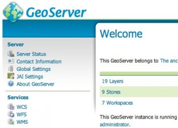
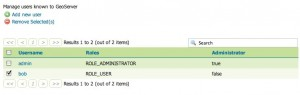

It has been a long time coming but it is finally here. GeoServer 2.0 has been officially released and is available for download. The 2.0 release marks a major milestone for the GeoServer project. A special thanks to all the developers who worked hard for this release, all the users who contributed bug reports, and for those who provided feedback by testing out the 2.0 release candidates.

So what is new in 2.0? The first new feature that people will notice is a completely new web administration interface. Based on the [Wicket](http://wicket.apache.org/) framework the new user interface provides a much more integrated and streamlined application for configuring GeoServer. Wicket makes developing ajax enabled applications trivial by doing all the hard work for you.

One of the powerful features of Wicket for the developer is extensibility. Wicket allows one to plug-in components dynamically. This means that developers can now easily write plug-ins and extensions for the GeoServer UI. And some have already done so. Francesco Izzi and the developers from the [geoSDI](http://www.geosdi.org/) project have contributed a plug-in for configuring the GeoServer security sub system. Special thanks for the great contribution.

The 2.0 release also hails the home coming of the "complex features" branch and true support for application schemas. Led by Ben Caradoc-Davies and Rini Angreani, developers from CSIRO have made this functionality available in the core of GeoServer. Special thanks to them and to [AuScope](http://www.auscope.org.au/) for funding the work. Check out the [documentation](http://docs.geoserver.org/trunk/en/user/data/app-schema/index.html) for more information about getting started with application schemas.

New features has not been the only focus of 2.0. Much work has also gone into scalability and performance in order to ensure that GeoServer continues to improve not only in terms of new features, but also that it continues to get faster.

Much of this work came in preparation for the [WMS Shootout](http://www.slideshare.net/gatewaygeomatics.com/wms-performance-shootout) at FOSS4G in Sydney this year. Great thanks goes out to Andrea Aime for not only representing GeoServer in this benchmarking exercise, but also for the countless number of hours he has poured into improving GeoServer performance and robustness.

As with any release many minor features and bug fixes have gone into 2.0. Be sure to check out the [GeoServer Past Present Future](http://www.slideshare.net/jdeolive/geoserver-past-present-future-2009) talk given at FOSS4G that provides an overview of what else has gone on this year in preparation for 2.0.

Download 2.0 now and try it out. Please help us to continue to improve GeoServer by reporting any issues you encounter on the [mailing list](mailto:geoserver-users@lists.sourceforge.net) and [bug tracker](https://osgeo-org.atlassian.net/issues/?jql=project%3DGEOS).

----

## GeoServer 2.0.0

Released on Oct 23, 09

> Ensure you read [Upgrading To 2.0](https://web.archive.org/web/20091027/http://geoserver.org/display/GEOS/Upgrading+To+2.0) before you install GeoServer 2.0 if you are upgrading from a previous GeoServer version.

#### Download format

- [Binary (OS independent)](https://sourceforge.net/projects/geoserver/files/GeoServer/2.0.0/geoserver-2.0.0a-bin.zip/download)
- [Web Archive](https://sourceforge.net/projects/geoserver/files/GeoServer/2.0.0/geoserver-2.0.0a-war.zip/download)
- [Windows Service Installer](https://sourceforge.net/projects/geoserver/files/GeoServer/2.0.0/geoserver-2.0.0a-ng.exe/download)
- [Windows Console Installer](https://sourceforge.net/projects/geoserver/files/GeoServer/2.0.0/geoserver-2.0.0a.exe/download)
- [Mac OS X Installer](https://sourceforge.net/projects/geoserver/files/GeoServer/2.0.0/geoserver-2.0.0a.dmg/download)
- [Source Code](https://sourceforge.net/projects/geoserver/files/GeoServer/2.0.0/geoserver-2.0.0-src.zip/download)

#### Documentation

- [HTML Documentation](https://sourceforge.net/projects/geoserver/files/GeoServer/2.0.0/geoserver-2.0.0-htmldoc.zip/download)
- [PDF Documentation](https://sourceforge.net/projects/geoserver/files/GeoServer/2.0.0/geoserver-2.0.0-pdfdoc.zip/download)
- [API Documentation](http://downloads.sourceforge.net/geoserver/geoserver-2.0.0-javadoc.zip)
- [Release Notes](https://sourceforge.net/projects/geoserver/files/GeoServer/2.0.0/release-notes-2.0.0.txt/download)
- [Change Log](#release-notes)

#### Extensions

**Data store**

- [Application Schema](https://sourceforge.net/projects/geoserver/files/GeoServer/2.0.0/extensions/geoserver-2.0.0-app-schema-plugin.zip/download)
- [ArcSDE](https://sourceforge.net/projects/geoserver/files/GeoServer/2.0.0/extensions/geoserver-2.0.0-arcsde-plugin.zip/download)
- [DB2](https://sourceforge.net/projects/geoserver/files/GeoServer/2.0.0/extensions/geoserver-2.0.0-db2-plugin.zip/download)
- [GML](http://downloads.sourceforge.net/geoserver/geoserver-2.0.0-gml-plugin.zip)
- [H2](https://sourceforge.net/projects/geoserver/files/GeoServer/2.0.0/extensions/geoserver-2.0.0-h2-plugin.zip/download)
- [MySQL](https://sourceforge.net/projects/geoserver/files/GeoServer/2.0.0/extensions/geoserver-2.0.0-mysql-plugin.zip/download)
- [Oracle](https://sourceforge.net/projects/geoserver/files/GeoServer/2.0.0/extensions/geoserver-2.0.0a-oracle-plugin.zip/download)
- [Pregeneralized features](https://sourceforge.net/projects/geoserver/files/GeoServer/2.0.0/extensions/geoserver-2.0.0-feature-pregeneralized-plugin.zip/download)
- [SQL Server](https://sourceforge.net/projects/geoserver/files/GeoServer/2.0.0/extensions/geoserver-2.0.0-sqlserver-plugin.zip/download)
- [VPF](https://sourceforge.net/projects/geoserver/files/GeoServer/2.0.0/extensions/geoserver-2.0.0-vpf-plugin.zip/download)

**Coverage store**

- [GDAL](https://sourceforge.net/projects/geoserver/files/GeoServer/2.0.0/extensions/geoserver-2.0.0-gdal-plugin.zip/download)
- [Image Pyramid](https://sourceforge.net/projects/geoserver/files/GeoServer/2.0.0/extensions/geoserver-2.0.0-pyramid-plugin.zip/download)
- [JDBC Image Mosaic](https://sourceforge.net/projects/geoserver/files/GeoServer/2.0.0/extensions/geoserver-2.0.0-imagemosaic-jdbc-plugin.zip/download)

**Other**

- [Chart dynamic symbolizer](https://sourceforge.net/projects/geoserver/files/GeoServer/2.0.0/extensions/geoserver-2.0.0-charts-plugin.zip/download)
- [GeoSearch](https://sourceforge.net/projects/geoserver/files/GeoServer/2.0.0/extensions/geoserver-2.0.0-geosearch-plugin.zip/download)
- [Image Map](https://sourceforge.net/projects/geoserver/files/GeoServer/2.0.0/extensions/geoserver-2.0.0-imagemap-plugin.zip/download)
- [OGR Output Format](https://sourceforge.net/projects/geoserver/files/GeoServer/2.0.0/extensions/geoserver-2.0.0-ogr-plugin.zip/download)
- [REST Config](https://sourceforge.net/projects/geoserver/files/GeoServer/2.0.0/extensions/geoserver-2.0.0-restconfig-plugin.zip/download)
- [WFS Versioning](https://sourceforge.net/projects/geoserver/files/GeoServer/2.0.0/extensions/geoserver-2.0.0-wfsv-plugin.zip/download)
- [Application schema](https://sourceforge.net/projects/geoserver/files/GeoServer/2.0.0/extensions/geoserver-2.0.0-app-schema-plugin.zip/download)
- [Web security UI](https://sourceforge.net/projects/geoserver/files/GeoServer/2.0.0/extensions/geoserver-2.0.0-web-security-plugin.zip/download)

#### [SourceForge](https://sourceforge.net/projects/geoserver/files/GeoServer/2.0.0/)

SourceForge Release .

#### [JIRA](https://osgeo-org.atlassian.net/issues/?jql=project%3DGEOS)

JIRA Version 15874

## Release notes

New Feature:

* [GEOS-2501](https://osgeo-org.atlassian.net/browse/GEOS-2501) Wicket user interface

Improvement:

* [GEOS-3446](https://osgeo-org.atlassian.net/browse/GEOS-3446) Replace OperationSecurityInterceptor with a dispatcher callback and remove the restriction on role naming
* [GEOS-3547](https://osgeo-org.atlassian.net/browse/GEOS-3547) Add a flag allowing users to switch fully to the streaming renderer

Bug:

* [GEOS-1788](https://osgeo-org.atlassian.net/browse/GEOS-1788) Demo Request screen mostly empty
* [GEOS-1800](https://osgeo-org.atlassian.net/browse/GEOS-1800) SRS help link points at old wiki instead of new one
* [GEOS-1853](https://osgeo-org.atlassian.net/browse/GEOS-1853) www folder refuses to serve data whose format is uknown
* [GEOS-3032](https://osgeo-org.atlassian.net/browse/GEOS-3032) IE 7 Styling Issues
* [GEOS-3554](https://osgeo-org.atlassian.net/browse/GEOS-3554) Data directories in svn trunk should be updated to be native to 2.0
* [GEOS-3595](https://osgeo-org.atlassian.net/browse/GEOS-3595) Rendering fails for shapefiles when dbf is not opened
* [GEOS-3602](https://osgeo-org.atlassian.net/browse/GEOS-3602) Upgrading from old data directory with Oracle and Postgis datastores fails
* [GEOS-3676](https://osgeo-org.atlassian.net/browse/GEOS-3676) SchemaLocations on the WFS output header are invalid
* [GEOS-3750](https://osgeo-org.atlassian.net/browse/GEOS-3750) Support anyType for complex attributes
* [GEOS-3751](https://osgeo-org.atlassian.net/browse/GEOS-3751) Test GEOS-3750: encoding anyType as complex attributes
