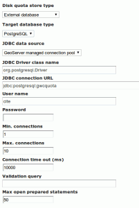
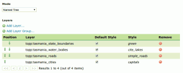
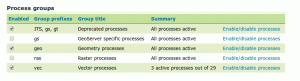
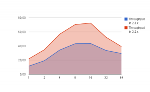

We’re happy to announce the release of GeoServer 2.3-beta and encourage you to download it, try out the great new features, and let us know if there are any bugs. Since this is a beta release, we recommend against deploying it in a production environment without first backing up and undertaking extensive testing.

Please report issues as soon as possible, as we expect the first release candidate as soon as next month. This beta release is the first new major release developed under the time-boxed development model and contains six months worth of improvements, including:

### Pluggable configuration storage subsystem

Thanks to [GSIP 69](https://web.archive.org/web/20130129/http://geoserver.org/display/GEOS/GSIP+69+-+Catalog+scalability+enhancements), the catalog and configuration storage subsystem is now pluggable and better suited to large scale deployments and large quantities of layers. In particular, we've developed a new community module allowing configuration to be stored in a relational database and tests show good performance even with millions of layers stored in it. We invite everybody interested in these capabilities to [download](http://gridlock.opengeo.org/geoserver/master/community-latest/geoserver-2.3-SNAPSHOT-jdbcconfig-plugin.zip) and try out the jdbcconfig module with nightly builds and provide feedback for its development. Thanks to [OpenGeo](http://opengeo.org/) for pushing the envelope in this area.

### GeoWebCache

As a result of  [GSIP 90](https://web.archive.org/web/20130129/http://geoserver.org/display/GEOS/GSIP+90+-+Upgrading+to+GWC+1.4.x), GeoWebCache has been upgraded to the 1.4.x series for significant improvements to our clustering story. In particular, the metastore has been removed, allowing all the meta-information about the tiles to be stored in the file system.
Also, the disk quota subsystem has been overhauled and the dependency for Berkeley DB Java edition has been dropped, allowing the usage of standard relational databases.  An embedded H2 database is used by default but an external database such as PostgreSQL or Oracle can be used as well to enable a cluster of GeoWebCache instances to all share the same disk quota information. Finally, on disk tile management has been improved to allow multiple instances of writing and reading in parallel without conflict. Thanks to the [Norwegian Public Road Authority](http://www.vegvesen.no/en/The+NPRA) for sponsoring the effort of [GeoSolutions](http://www.geo-solutions.it/).

### LayerGroup improvements

As part of [GSIP 84](https://web.archive.org/web/20130129/http://geoserver.org/display/GEOS/GSIP+84+-+Control+how+layer+groups+are+exposed+in+the+WMS+capabilities+document) and [GSIP 85](https://web.archive.org/web/20130129/http://geoserver.org/display/GEOS/GSIP+85+-+Nested+layer+groups), LayerGroup functionality has been significantly improved to allow not only grouping of layers but also to expose the inner structure of the group in the capabilites document and also nested layer groups to form a full-fledged tree. A layer can be nested in more than one tree to provide flexibility when presenting the information to WMS clients. It's also now possible to specify a custom title and abstract for a LayerGroup to better describe it in the capabilities document.
Find out more in the [GeoServer documentation](http://docs.geoserver.org/latest/en/user/webadmin/data/layergroups.html). Thanks to [GeoSolutions](http://www.geo-solutions.it/) for performing the work and [DLR](http://www.dlr.de) and [EUMETSAT](http://www.eumetsat.int/Home/index.htm) for sponsoring it.

### Security subsystem improvement

The security subsystem has been improved thanks to [GSIP 82](https://web.archive.org/web/20130129/http://geoserver.org/display/GEOS/GSIP+82+-+Reworking+security+filter+chains) and [GSIP 91](https://web.archive.org/web/20130129/http://geoserver.org/display/GEOS/GSIP+91+-+Enhance+authentication+filter+chain+configuration). Both improvements target the security authentication chains, making them more flexible and easier to configure as well as improving the user interface. Administrators can now create custom authentication chains and associated them to the different URLs GeoServer exposes. Authentication chains can enforce SSL connections and send back roles for authenticated principals in an HTTP response header attribute. It is also possible to disable security for a chain. The filter chain matching is extended to optionally check the HTTP method(s) of an incoming request—for example, giving anonymous access for GET and POST but requiring basic authentication for PUT and DELETE.

Both the Central Authentication Service (CAS) subsystem and the [authkey](http://docs.geoserver.org/latest/en/user/community/authkey/index.html) community module have also been made functional again.

Many thanks to Christian Mueller for the continued work on the security subsystem.

### WPS process selection

The WPS configuration panel now allows the administrator to select which processes to expose to clients, making it possible to expose just a selected few and thereby improving the performance and stability of the server. Thanks to [GeoSolutions](http://www.geo-solutions.it/) for developing this new functionality.

### WMS dimension support improvements

While 2.2.x series added support for time and elevation in WMS, the 2.3.x series brings significant improvements in this area. In particular:

	
  * Dimensions can now be associated with a unit symbol and a unit dimension. Thanks for [Michael Romero](https://github.com/geoserver/geoserver/pull/7) for providing this improvement.

	
  * User-defined dimensions are now supported for raster data, allowing dimensions other than time and elevation to be advertised and managed via WMS. Thanks to [Mike Benowitz](https://github.com/geoserver/geoserver/pull/16) for providing this improvement.

	
  * Image mosaic can now gather and manage custom dimensions. Thanks to [GeoSolutions](http://www.geo-solutions.it/) for developing this under [DLR](http://www.dlr.de) and [EUMETSAT](http://www.eumetsat.int/Home/index.htm) sponsorship.

### Monitoring extension

The [monitoring](http://docs.geoserver.org/latest/en/user/extensions/monitoring/index.html) module graduated from community module to extension, and gained new functionality in the process:

	
  * The system can now gather more information about requests, such as HTTP referrer and better support for requested BBOX

	
  * The storage subsystem has been made pluggable, with the Hibernate classic one being the default implementation

Thanks to [OpenGeo](http://opengeo.org/) for pushing the envelope on this one.

### JSON all over

JSON and JSONP support has been added in several places to support JavaScript development:

	
  * WMS GetFeatureInfo output format

	
  * WMS Describelayer

	
  * WFS DescribeFeatureType (as JSON schema)

	
  * WMS exceptions can now be requested in JSON format as well

Thanks to [GeoSolutions](http://www.geo-solutions.it/) for developing these improvements with [FAO](http://www.fao.org/) sponsorship.

### Gather information about what's installed in your GeoServer

The work performed under [GSIP 83](http://geoserver.org/pages/viewpage.action?pageId=55574531) is going to make  it easier to manage several GeoServer installations. This work added a REST API allowing administrators to gather information about all the libraries included in a certain GeoServer installation and answer questions such as:

	
  * What precise version of GeoServer and GeoTools are used in a certain installation?

	
  * What extensions and community modules are included?

	
  * What java libraries are available in the installation, and what version?

Thanks to [GeoSolutions](http://www.geo-solutions.it/) for developing these improvements with [FAO](http://www.fao.org/) sponsorship.

### INSPIRE module improvements

The INSPIRE community module has been enhanced and now provides INSPIRE specific metadata in the WFS 1.1 and 2.0 capabilities modules, bringing GeoServer closer to full WFS compliance under the INSPIRE requirements. Thanks for [camptocamp](http://www.camptocamp.com/) for the development, and to [IGN France](http://www.ign.fr/).

### Raster data management improvements

Raster data management has been significantly improved in GeoServer 2.3-beta. In particular we worked on raster data reprojection, eliminating artifacts occurring at raster borders during reprojection with better NODATA management, and significantly improving reprojection performance by streamlining the set of operations done while reprojecting a raster. We ran the WMS 2010 shootout raster reprojection tests with 2.2.x and 2.3.x and here is the speedup you can expect (the graph compares requests per second vs number of concurrent requests, click to enlarge):

Thanks to [GeoSolutions](http://www.geo-solutions.it/) and [OpenGeo](http://opengeo.org/) for pushing the envelope in this area.

### Testing subsystem overhaul

Some good news for developers... If you are developing extensions, improvements, or bug fixes against GeoServer 2.2.x the slowness of the test subsystem was probably something you noticed. [Months ago a team of GeoServer developers met in Vienna to improve this](), creating a new set of base classes for testing and upgrading the whole system to JUnit 4 in the process. The new test subsystem is significantly faster, making development on the 2.3.x series much nicer.

### OSGeo incubation progress

GeoServer OSGeo incubation is well underway and approaching completion. Special thanks to the team of developers that met in Australia to perform the code and data provenance review, we all know it's tedious but necessary step in the incubation process. Each finding was documented as a JIRA issue, resulting in a large number of them in the 2.3.x changelog.

### Everything else

The [GeoServer 2.3-beta detailed release notes](#release-notes) contain a lot more details, as well as other changes that we haven't included in the announcement for brevity's sake. It's also worth having a look into the corresponding [GeoTools 9.0-M1](#release-notes) and [9.0-beta](#release-notes) changelogs, as GeoServer inherits significant improvements made in GeoTools.

### More interesting stuff cooking in community land

While still not ready for prime time, the current development series contains a couple of very interesting new community modules:

	
  * A **CSW service** with pluggable backends and record frontends. The current backends can serve Dublin Core records out of the file system, and ISO records reflecting the current set of layers in the GeoServer configuration, making GeoServer self hosted in terms of layer searchability. Thanks to Niels Charlier, [GeoSolutions](http://www.geo-solutions.it/), and [OpenGeo](http://opengeo.org/) for pushing the envelope in this area.

	
  * A **WCS 2.0 service** with full EO extension is in the works. The module is being developed by [GeoSolutions](http://www.geo-solutions.it/), with sponsorship from [DLR](http://www.dlr.de) and [EUMETSAT](http://www.eumetsat.int/Home/index.htm).

	
  * Several **[scripting modules](http://docs.geoserver.org/latest/en/user/community/scripting/index.html)** supporting languages such as Python, Groovy, Beanshell, Ruby, and Javascript allow one to script WPS processes as well as little applications. Thanks to [OpenGeo](http://opengeo.org/) for this awesome improvement.

	
  * A **[W3DS service](http://osgeo-org.1560.n6.nabble.com/W3DS-Service-as-a-Community-Module-td5026763.html)** has been added recently, allowing GeoServer to serve 3D data and scenes via OGC protocols. Many thanks to Nuno Oliveira for this exciting new development.

### Conclusions

Everyone who uses GeoServer should have at least one or two items in the above list to get excited about. [Download GeoServer 2.3-beta](https://web.archive.org/web/20130129/http://geoserver.org/display/GEOS/GeoServer+2.2-beta1), try it out, and please provide feedback and report any issues on the [GeoServer mailing list](https://web.archive.org/web/20130129/http://geoserver.org/display/GEOS/Mailing+Lists).  As with any beta version, _be sure to backup your data directory before upgrading_.

----

## [GeoServer 2.3-beta1](https://web.archive.org/web/20130129/http://geoserver.org/display/GEOS/GeoServer+2.3-beta1)

Released on Jan 25, 2013

#### Download format

- [Binary (OS independent)](https://sourceforge.net/projects/geoserver/files/GeoServer/2.3-beta1/geoserver-2.3-beta1-bin.zip/download)
- [Web Archive](https://sourceforge.net/projects/geoserver/files/GeoServer/2.3-beta1/geoserver-2.3-beta1-war.zip/download)
- [Windows Installer](https://sourceforge.net/projects/geoserver/files/GeoServer/2.3-beta1/geoserver-2.3-beta1.exe/download)
- [Mac OS X Installer](https://sourceforge.net/projects/geoserver/files/GeoServer/2.3-beta1/geoserver-2.3-beta1.dmg/download)
- [Source Code](https://sourceforge.net/projects/geoserver/files/GeoServer/2.3-beta1/geoserver-2.3-beta1-src.zip/download)

#### Documentation

- [HTML Documentation](http://sourceforge.net/projects/geoserver/files/GeoServer/2.3-beta1/geoserver-2.3-beta1-htmldoc.zip/download)
- [API Documentation](http://sourceforge.net/projects/geoserver/files/GeoServer/2.3-beta1/geoserver-2.3-beta1-javadoc.zip/download)
- [Change Log](#release-notes)

#### Extensions

**Data store**

- [Application Schema](https://sourceforge.net/projects/geoserver/files/GeoServer/2.3-beta1/extensions/geoserver-2.3-beta1-app-schema-plugin.zip/download)
- [ArcSDE](https://sourceforge.net/projects/geoserver/files/GeoServer/2.3-beta1/extensions/geoserver-2.3-beta1-arcsde-plugin.zip/download)
- [DB2](https://sourceforge.net/projects/geoserver/files/GeoServer/2.3-beta1/extensions/geoserver-2.3-beta1-db2-plugin.zip/download)
- [H2](https://sourceforge.net/projects/geoserver/files/GeoServer/2.3-beta1/extensions/geoserver-2.3-beta1-h2-plugin.zip/download)
- [MySQL](https://sourceforge.net/projects/geoserver/files/GeoServer/2.3-beta1/extensions/geoserver-2.3-beta1-mysql-plugin.zip/download)
- [Oracle](https://sourceforge.net/projects/geoserver/files/GeoServer/2.3-beta1/extensions/geoserver-2.3-beta1-oracle-plugin.zip/download)
- [Pregeneralized features](https://sourceforge.net/projects/geoserver/files/GeoServer/2.3-beta1/extensions/geoserver-2.3-beta1-feature-pregeneralized-plugin.zip/download)
- [SQL Server](https://sourceforge.net/projects/geoserver/files/GeoServer/2.3-beta1/extensions/geoserver-2.3-beta1-sqlserver-plugin.zip/download)
- [Teradata](https://sourceforge.net/projects/geoserver/files/GeoServer/2.3-beta1/extensions/geoserver-2.3-beta1-teradata-plugin.zip/download)
- [VPF](https://sourceforge.net/projects/geoserver/files/GeoServer/2.3-beta1/extensions/geoserver-2.3-beta1-vpf-plugin.zip/download)

**Coverage store**

- [GDAL](https://sourceforge.net/projects/geoserver/files/GeoServer/2.3-beta1/extensions/geoserver-2.3-beta1-gdal-plugin.zip/download)
- [Image Pyramid](https://sourceforge.net/projects/geoserver/files/GeoServer/2.3-beta1/extensions/geoserver-2.3-beta1-pyramid-plugin.zip/download)
- [JPEG2000](https://sourceforge.net/projects/geoserver/files/GeoServer/2.3-beta1/extensions/geoserver-2.3-beta1-jp2k-plugin.zip/download)
- [JDBC Image Mosaic](https://sourceforge.net/projects/geoserver/files/GeoServer/2.3-beta1/extensions/geoserver-2.3-beta1-imagemosaic-jdbc-plugin.zip/download)

**Other**

- [Chart dynamic symbolizer](https://sourceforge.net/projects/geoserver/files/GeoServer/2.3-beta1/extensions/geoserver-2.3-beta1-charts-plugin.zip/download)
- [Control flow](https://sourceforge.net/projects/geoserver/files/GeoServer/2.3-beta1/extensions/geoserver-2.3-beta1-control-flow-plugin.zip/download)
- [Cross layer filtering](https://sourceforge.net/projects/geoserver/files/GeoServer/2.3-beta1/extensions/geoserver-2.3-beta1-querylayer-plugin.zip/download)
- [Excel output format](https://sourceforge.net/projects/geoserver/files/GeoServer/2.3-beta1/extensions/geoserver-2.3-beta1-excel-plugin.zip/download)
- [GeoSearch](https://sourceforge.net/projects/geoserver/files/GeoServer/2.3-beta1/extensions/geoserver-2.3-beta1-geosearch-plugin.zip/download)
- [Image Map output format](https://sourceforge.net/projects/geoserver/files/GeoServer/2.3-beta1/extensions/geoserver-2.3-beta1-imagemap-plugin.zip/download)
- [OGR output format](https://sourceforge.net/projects/geoserver/files/GeoServer/2.3-beta1/extensions/geoserver-2.3-beta1-ogr-plugin.zip/download)
- [WPS](https://sourceforge.net/projects/geoserver/files/GeoServer/2.3-beta1/extensions/geoserver-2.3-beta1-wps-plugin.zip/download)
- [CAS](https://sourceforge.net/projects/geoserver/files/GeoServer/2.3-beta1/extensions/geoserver-2.3-beta1-cas-plugin.zip/download)
- Monitor ([Core](https://sourceforge.net/projects/geoserver/files/GeoServer/2.3-beta1/extensions/geoserver-2.3-beta1-monitor-plugin.zip/download), [Hibernate](https://sourceforge.net/projects/geoserver/files/GeoServer/2.3-beta1/extensions/geoserver-2.3-beta1-monitor-hibernate-plugin.zip/download))

#### [JIRA](https://osgeo-org.atlassian.net/issues/?jql=project%3DGEOS)

JIRA Version 18651

## Release notes

New Feature:

* [GEOS-4982](https://osgeo-org.atlassian.net/browse/GEOS-4982) LayerGroup does not show up in capabilities if one of its layers is non-advertised
* [GEOS-5263](https://osgeo-org.atlassian.net/browse/GEOS-5263) Allow the administrator to select which processes to expose to the users

Improvement:

* [GEOS-1640](https://osgeo-org.atlassian.net/browse/GEOS-1640) Move all wfsv stuff onto the wfs namespace
* [GEOS-1689](https://osgeo-org.atlassian.net/browse/GEOS-1689) WCS output formats should be pluggable
* [GEOS-2316](https://osgeo-org.atlassian.net/browse/GEOS-2316) Consolitate WFSXmlParser classes
* [GEOS-2666](https://osgeo-org.atlassian.net/browse/GEOS-2666) Add an extension point to parse VendorElement elements in WFS transactions
* [GEOS-5212](https://osgeo-org.atlassian.net/browse/GEOS-5212) Support EPSG:102113 as an alias for web mercator
* [GEOS-5218](https://osgeo-org.atlassian.net/browse/GEOS-5218) WMS elevation dimension units should be editable
* [GEOS-5247](https://osgeo-org.atlassian.net/browse/GEOS-5247) Json[p] WFS and WMS exceptionHandler
* [GEOS-5256](https://osgeo-org.atlassian.net/browse/GEOS-5256) Use admin password as master password during migration
* [GEOS-5260](https://osgeo-org.atlassian.net/browse/GEOS-5260) GSIP 69 - Catalog scalability enhancements
* [GEOS-5261](https://osgeo-org.atlassian.net/browse/GEOS-5261) CLONE - WMS GetLegendGraphic should output labels if no Rule is specified
* [GEOS-5271](https://osgeo-org.atlassian.net/browse/GEOS-5271) Create a process factory to handle deprecated process names
* [GEOS-5278](https://osgeo-org.atlassian.net/browse/GEOS-5278) Geoserver Tomcat init script
* [GEOS-5280](https://osgeo-org.atlassian.net/browse/GEOS-5280) Treat reduced-accuracy times as ranges in WMS
* [GEOS-5308](https://osgeo-org.atlassian.net/browse/GEOS-5308) Additional Debug Options for Metatiling and Quantization
* [GEOS-5321](https://osgeo-org.atlassian.net/browse/GEOS-5321) Finalize migrating CAS to an extension
* [GEOS-5352](https://osgeo-org.atlassian.net/browse/GEOS-5352) Use JDK Xalan to reduce PermGen consumption
* [GEOS-5353](https://osgeo-org.atlassian.net/browse/GEOS-5353) Intermittent build failure in ServiceAccessRulePageTest
* [GEOS-5366](https://osgeo-org.atlassian.net/browse/GEOS-5366) Better heuristic for OWS Request filenames
* [GEOS-5524](https://osgeo-org.atlassian.net/browse/GEOS-5524) Adding LayerGroup support to GetLegendGraphic WMS operation
* [GEOS-5538](https://osgeo-org.atlassian.net/browse/GEOS-5538) Promote monitor module to extension
* [GEOS-5548](https://osgeo-org.atlassian.net/browse/GEOS-5548) Nested layer groups
* [GEOS-5554](https://osgeo-org.atlassian.net/browse/GEOS-5554) Add a role service parsing roles from web.xml
* [GEOS-5557](https://osgeo-org.atlassian.net/browse/GEOS-5557) Enhance API for GeoserverUserGroupService
* [GEOS-5558](https://osgeo-org.atlassian.net/browse/GEOS-5558) Integrating the AuthKey module into the new security architecture
* [GEOS-5561](https://osgeo-org.atlassian.net/browse/GEOS-5561) Missing i18n support for ReprojectPage
* [GEOS-5562](https://osgeo-org.atlassian.net/browse/GEOS-5562) Missing i18n support for WorkspaceEditPage
* [GEOS-5563](https://osgeo-org.atlassian.net/browse/GEOS-5563) slight mixed up order of Y-parameters in AffineTransformPanel
* [GEOS-5569](https://osgeo-org.atlassian.net/browse/GEOS-5569) Missing i18n support for CatalogStressTester
* [GEOS-5580](https://osgeo-org.atlassian.net/browse/GEOS-5580) GSIP 82 - Reworking security filter chains
* [GEOS-5581](https://osgeo-org.atlassian.net/browse/GEOS-5581) GMLGrid output format for WCS
* [GEOS-5582](https://osgeo-org.atlassian.net/browse/GEOS-5582) CSW community module
* [GEOS-5583](https://osgeo-org.atlassian.net/browse/GEOS-5583) DXF output for WPS
* [GEOS-5584](https://osgeo-org.atlassian.net/browse/GEOS-5584) Having monitoring extension capture bounding box information

Bug:

* [GEOS-1637](https://osgeo-org.atlassian.net/browse/GEOS-1637) Versioned feature elements in versioned feature collection should be prefixed by wfsv
* [GEOS-1962](https://osgeo-org.atlassian.net/browse/GEOS-1962) Linestring data type containing 1 point causes errors
* [GEOS-2193](https://osgeo-org.atlassian.net/browse/GEOS-2193) GetLog results don't agree with fromFeatureVersion and toFeatureVersion parameters
* [GEOS-4173](https://osgeo-org.atlassian.net/browse/GEOS-4173) does not work proxy extention module
* [GEOS-4648](https://osgeo-org.atlassian.net/browse/GEOS-4648) GWC should filter out layer without a geometry
* [GEOS-4698](https://osgeo-org.atlassian.net/browse/GEOS-4698) searching invalid workspace name results in exception
* [GEOS-4699](https://osgeo-org.atlassian.net/browse/GEOS-4699) no capabilities request possible with wrong coverage configuration
* [GEOS-4857](https://osgeo-org.atlassian.net/browse/GEOS-4857) PostGIS Layer Leaking Connection when using WMS getFeatureInfo calls in Layer Preview (Open Layers)
* [GEOS-5121](https://osgeo-org.atlassian.net/browse/GEOS-5121) CatalogImpl allows to add multiple layers for a given ResourceInfo leaving the catalog in an inconsistent state
* [GEOS-5135](https://osgeo-org.atlassian.net/browse/GEOS-5135) Incorrect canonical schema location in WFS 2.0.0 GetCapabilities response
* [GEOS-5157](https://osgeo-org.atlassian.net/browse/GEOS-5157) Can't configure MediaType in INSPIRE extension
* [GEOS-5167](https://osgeo-org.atlassian.net/browse/GEOS-5167) Metadata URL in WMS 1.3.0 capabilities is wrong host is localhost
* [GEOS-5219](https://osgeo-org.atlassian.net/browse/GEOS-5219) WMS 1.3 cite tests fail on metadata mime type
* [GEOS-5226](https://osgeo-org.atlassian.net/browse/GEOS-5226) The coverage settings are getting re-initialized at each and every catalog modification
* [GEOS-5227](https://osgeo-org.atlassian.net/browse/GEOS-5227) The coverage settings page does not validate the thread pool min and max size
* [GEOS-5257](https://osgeo-org.atlassian.net/browse/GEOS-5257) Intermittent build failure in main XMLUserGroupServiceTest
* [GEOS-5259](https://osgeo-org.atlassian.net/browse/GEOS-5259) GeoServer security subsytem fails to migrate previously valid user names
* [GEOS-5265](https://osgeo-org.atlassian.net/browse/GEOS-5265) Add support for custom WMS/WCS dimensions on grid coverage readers
* [GEOS-5275](https://osgeo-org.atlassian.net/browse/GEOS-5275) Edit user page uses XML store regardless of
* [GEOS-5277](https://osgeo-org.atlassian.net/browse/GEOS-5277) VendorSpecificCapabilities invalidates WMS 1.1.1 GetCapabilities
* [GEOS-5279](https://osgeo-org.atlassian.net/browse/GEOS-5279) ImageMosaic Filter option does not work
* [GEOS-5281](https://osgeo-org.atlassian.net/browse/GEOS-5281) Documentation on "Security » Role system » Role services" has incorrect tablename for the role sevice schema
* [GEOS-5284](https://osgeo-org.atlassian.net/browse/GEOS-5284) wfsTransactioninsert demo request fails
* [GEOS-5293](https://osgeo-org.atlassian.net/browse/GEOS-5293) CAS proxy tickets must not be used as key for the authentication cache
* [GEOS-5294](https://osgeo-org.atlassian.net/browse/GEOS-5294) Valid CAS service tickets must result in an HTTP session creation
* [GEOS-5298](https://osgeo-org.atlassian.net/browse/GEOS-5298) WPS Execute fails with layer name clash
* [GEOS-5301](https://osgeo-org.atlassian.net/browse/GEOS-5301) CatalogBuilder.setupMetadata doesn't handle FeatureSource.getInfo() throwing exception
* [GEOS-5306](https://osgeo-org.atlassian.net/browse/GEOS-5306) GWC TransactionListener doesn't clears cache on Transaction
* [GEOS-5309](https://osgeo-org.atlassian.net/browse/GEOS-5309) Authentication Filters may create an HTTP session on authentication failure
* [GEOS-5310](https://osgeo-org.atlassian.net/browse/GEOS-5310) WPS:Reproject process fails to perform reprojections with datum change if bursa-wolf params are not available
* [GEOS-5315](https://osgeo-org.atlassian.net/browse/GEOS-5315) WPS request builder incorrectly formats input
* [GEOS-5324](https://osgeo-org.atlassian.net/browse/GEOS-5324) Unable to configure or read already configured layergroup with name in the form 'test:foo'
* [GEOS-5332](https://osgeo-org.atlassian.net/browse/GEOS-5332) KMLTransformer does not include sld and vendor parameters into the request
* [GEOS-5343](https://osgeo-org.atlassian.net/browse/GEOS-5343) DefaultWebCoverageService100.java does not pass a grid geometry to the reader
* [GEOS-5345](https://osgeo-org.atlassian.net/browse/GEOS-5345) Grid coverages generated by WCS 1.0 and 1.1 are not getting disposed at the end of the call
* [GEOS-5346](https://osgeo-org.atlassian.net/browse/GEOS-5346) WCS 1.1 resolution estimation broken on reprojection
* [GEOS-5350](https://osgeo-org.atlassian.net/browse/GEOS-5350) Build failures in wps-core on master and 2.2.x
* [GEOS-5359](https://osgeo-org.atlassian.net/browse/GEOS-5359) gwc does not honor geoserver's proxy url
* [GEOS-5363](https://osgeo-org.atlassian.net/browse/GEOS-5363) geoserver username/password filter uses invalid login form url
* [GEOS-5364](https://osgeo-org.atlassian.net/browse/GEOS-5364) WPS code may fail to release coverage objects, which may result in file locks on windows
* [GEOS-5376](https://osgeo-org.atlassian.net/browse/GEOS-5376) Line sizes with UOM in legend decoration are doubly scaled when using DPI
* [GEOS-5377](https://osgeo-org.atlassian.net/browse/GEOS-5377) WMS GetFeatureInfo fails when post filter required
* [GEOS-5378](https://osgeo-org.atlassian.net/browse/GEOS-5378) Rest config and ogr2ogr failures under JDK7
* [GEOS-5386](https://osgeo-org.atlassian.net/browse/GEOS-5386) Build failure in GWCIntegrationTest if second layer is cite:Geometryless
* [GEOS-5388](https://osgeo-org.atlassian.net/browse/GEOS-5388) Confusing 'Bad credentials forroot' exception in verbose_logging mode when logged in as admin or root
* [GEOS-5396](https://osgeo-org.atlassian.net/browse/GEOS-5396) KML scale computation does not follow OGC recommendations
* [GEOS-5398](https://osgeo-org.atlassian.net/browse/GEOS-5398) FeatureCollection clean up
* [GEOS-5402](https://osgeo-org.atlassian.net/browse/GEOS-5402) Subclasses of GeoServerPreAuthenticationFilter do not map local admin roles to global admin roles
* [GEOS-5465](https://osgeo-org.atlassian.net/browse/GEOS-5465) OGC CITE sample data requires official software notice
* [GEOS-5467](https://osgeo-org.atlassian.net/browse/GEOS-5467) Comment header for applicationContext.xml
* [GEOS-5471](https://osgeo-org.atlassian.net/browse/GEOS-5471) Review WFSV as it has been replaced by GeoGit
* [GEOS-5474](https://osgeo-org.atlassian.net/browse/GEOS-5474) Adding Layer with 2.5D geometry trips up over number of ordinates when generating initial bounds
* [GEOS-5475](https://osgeo-org.atlassian.net/browse/GEOS-5475) GetCapabilities Generation fails when encountering 3D SRS
* [GEOS-5477](https://osgeo-org.atlassian.net/browse/GEOS-5477) Check app-schema tutorial data license
* [GEOS-5537](https://osgeo-org.atlassian.net/browse/GEOS-5537) Tiling artifacts with RasterSymbolizer using bilinear interpolation
* [GEOS-5539](https://osgeo-org.atlassian.net/browse/GEOS-5539) Support raster custom dimensions generated at runtime
* [GEOS-5566](https://osgeo-org.atlassian.net/browse/GEOS-5566) ServiceInfoCapabilitiesProvider should work with Service classes not ServiceInfo
* [GEOS-5572](https://osgeo-org.atlassian.net/browse/GEOS-5572) GSIP 90 - Upgrading to GWC 1.4.x
* [GEOS-5575](https://osgeo-org.atlassian.net/browse/GEOS-5575) GSIP 83 - rest extensible and customizable version report
* [GEOS-5576](https://osgeo-org.atlassian.net/browse/GEOS-5576) W3DS community module
* [GEOS-5577](https://osgeo-org.atlassian.net/browse/GEOS-5577) GSIP-86 - some refactoring of monitor extension and moving to extension
* [GEOS-5578](https://osgeo-org.atlassian.net/browse/GEOS-5578) New community module: WCS 2.0
* [GEOS-5585](https://osgeo-org.atlassian.net/browse/GEOS-5585) Coverage import process: add the ability to set a style
* [GEOS-5586](https://osgeo-org.atlassian.net/browse/GEOS-5586) XSLT WFS output format - new community module
* [GEOS-5646](https://osgeo-org.atlassian.net/browse/GEOS-5646) Monitoring extension graduation makes chart plugin assembly pick the wrong version of jfreechart

Task:

* [GEOS-5217](https://osgeo-org.atlassian.net/browse/GEOS-5217) update geoserver release documentation
* [GEOS-5289](https://osgeo-org.atlassian.net/browse/GEOS-5289) Update ImageIO-Ext documentation
* [GEOS-5406](https://osgeo-org.atlassian.net/browse/GEOS-5406) Provenance Review - db2
* [GEOS-5408](https://osgeo-org.atlassian.net/browse/GEOS-5408) Provenance Review - arcsde
* [GEOS-5409](https://osgeo-org.atlassian.net/browse/GEOS-5409) Provenance Review - charts
* [GEOS-5410](https://osgeo-org.atlassian.net/browse/GEOS-5410) Provenance Review - control-flow
* [GEOS-5411](https://osgeo-org.atlassian.net/browse/GEOS-5411) Provenance Review - excel
* [GEOS-5412](https://osgeo-org.atlassian.net/browse/GEOS-5412) Provenance Review - feature-pregeneralized
* [GEOS-5413](https://osgeo-org.atlassian.net/browse/GEOS-5413) Provenance Review - gdal
* [GEOS-5414](https://osgeo-org.atlassian.net/browse/GEOS-5414) Provenance Review - geosearch
* [GEOS-5415](https://osgeo-org.atlassian.net/browse/GEOS-5415) Provenance Review - h2
* [GEOS-5416](https://osgeo-org.atlassian.net/browse/GEOS-5416) Provenance Review - imagemap
* [GEOS-5417](https://osgeo-org.atlassian.net/browse/GEOS-5417) Provenance Review - imagemosaic-jdbc
* [GEOS-5418](https://osgeo-org.atlassian.net/browse/GEOS-5418) Provenance Review - jp2k
* [GEOS-5419](https://osgeo-org.atlassian.net/browse/GEOS-5419) Provenance Review - mysql
* [GEOS-5421](https://osgeo-org.atlassian.net/browse/GEOS-5421) Provenance Review - oracle
* [GEOS-5422](https://osgeo-org.atlassian.net/browse/GEOS-5422) Provenance Review - querylayer
* [GEOS-5424](https://osgeo-org.atlassian.net/browse/GEOS-5424) Provenance Review - sqlserver
* [GEOS-5425](https://osgeo-org.atlassian.net/browse/GEOS-5425) Provenance Review - teradata
* [GEOS-5426](https://osgeo-org.atlassian.net/browse/GEOS-5426) Provenance Review - validation
* [GEOS-5428](https://osgeo-org.atlassian.net/browse/GEOS-5428) Provenance Review - gwc
* [GEOS-5429](https://osgeo-org.atlassian.net/browse/GEOS-5429) Provenance Review - main
* [GEOS-5431](https://osgeo-org.atlassian.net/browse/GEOS-5431) Provenance Review - ows
* [GEOS-5432](https://osgeo-org.atlassian.net/browse/GEOS-5432) Provenance Review - platform
* [GEOS-5433](https://osgeo-org.atlassian.net/browse/GEOS-5433) Provenance Review - release
* [GEOS-5434](https://osgeo-org.atlassian.net/browse/GEOS-5434) Provenance Review - rest
* [GEOS-5435](https://osgeo-org.atlassian.net/browse/GEOS-5435) Provenance Review - restconfig
* [GEOS-5437](https://osgeo-org.atlassian.net/browse/GEOS-5437) Provenance Review - web app
* [GEOS-5438](https://osgeo-org.atlassian.net/browse/GEOS-5438) Provenance Review - security jdbc
* [GEOS-5439](https://osgeo-org.atlassian.net/browse/GEOS-5439) Provenance Review - web core
* [GEOS-5440](https://osgeo-org.atlassian.net/browse/GEOS-5440) Provenance Review - ldap
* [GEOS-5442](https://osgeo-org.atlassian.net/browse/GEOS-5442) Provenance Review - web / gwc
* [GEOS-5446](https://osgeo-org.atlassian.net/browse/GEOS-5446) Provenance Review - web / wfs
* [GEOS-5447](https://osgeo-org.atlassian.net/browse/GEOS-5447) Provenance Review - wcs1_0
* [GEOS-5449](https://osgeo-org.atlassian.net/browse/GEOS-5449) Provenance Review - wfs
* [GEOS-5451](https://osgeo-org.atlassian.net/browse/GEOS-5451) Provenance Review - wcs1_1

Sub-task:

* [GEOS-5453](https://osgeo-org.atlassian.net/browse/GEOS-5453) UCSReader under Apache 1.1 License
* [GEOS-5454](https://osgeo-org.atlassian.net/browse/GEOS-5454) RewindableInputStream borrowed from Xerces
* [GEOS-5455](https://osgeo-org.atlassian.net/browse/GEOS-5455) Files such as XMLSchemaTranslator contributed by Refractions Research contain default Eclipse generated comment
* [GEOS-5456](https://osgeo-org.atlassian.net/browse/GEOS-5456) Browser.java by by Eric Albert
* [GEOS-5459](https://osgeo-org.atlassian.net/browse/GEOS-5459) TimePeriodTypeBinding and TimeSequenceTypeBinding from GeoTools LGPL
* [GEOS-5460](https://osgeo-org.atlassian.net/browse/GEOS-5460) GZIPResponseStream freely use commercially and non-commercially
* [GEOS-5468](https://osgeo-org.atlassian.net/browse/GEOS-5468) WMS module contains some GeoTools LGPL headers
* [GEOS-5469](https://osgeo-org.atlassian.net/browse/GEOS-5469) WPS JAIToolsRangeConverterFactory uses GeoTools LGPL header
* [GEOS-5470](https://osgeo-org.atlassian.net/browse/GEOS-5470) SetCharacterEncodingFilter provided under Apache License 2.0

Wish:

* [GEOS-1945](https://osgeo-org.atlassian.net/browse/GEOS-1945) Difficulty finding outputFormats for GetDiff request
