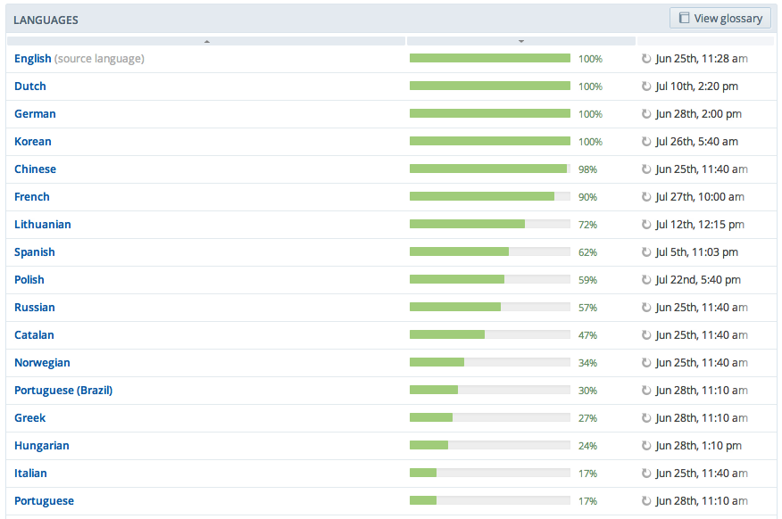

The GeoServer team is pleased to announce the release of GeoServer 2.3.4:

	
  * Downloads ([zip](https://sourceforge.net/projects/geoserver/files/GeoServer/2.3.4/geoserver-2.3.4-bin.zip/download), [war](https://sourceforge.net/projects/geoserver/files/GeoServer/2.3.4/geoserver-2.3.4-war.zip/download), [dmg](https://sourceforge.net/projects/geoserver/files/GeoServer/2.3.4/geoserver-2.3.4.dmg/download) and [exe](https://sourceforge.net/projects/geoserver/files/GeoServer/2.3.4/geoserver-2.3.4.exe/download)) are listed on the GeoServer 2.3.4 page along with documentation and extensions.

	
    * This release includes and is made in conjunction with [GeoTools 9.4](http://geotoolsnews.blogspot.it/2013/07/geotools-94-released.html).

	
  * Thanks to [Envitia](http://www.envitia.com) for allowing Ian the time to make the release.

	
  * Migrated CSS module to extensions section ([GEOS-5845](https://osgeo-org.atlassian.net/browse/GEOS-5845))

	
  * Several improvements and bug-fixes in WMS and Security sub-systems.

	
  * Thanks to Frank Gasdorf managing [Transifex GeoServer Translation Teams](https://www.transifex.com/projects/p/geoserver_stable)

	
    * contributed initial language support (almost) complete for [Dutch](https://www.transifex.com/projects/p/geoserver_stable/language/nl/members/) and [Chinese](https://www.transifex.com/projects/p/geoserver_stable/language/zh/members/) ([GEOS-5926](https://osgeo-org.atlassian.net/browse/GEOS-5926) + [GEOS-5924](https://osgeo-org.atlassian.net/browse/GEOS-5924))

	
    * updated translations for [Korean](https://www.transifex.com/projects/p/geoserver_stable/language/ko/members/) and [German](https://www.transifex.com/projects/p/geoserver_stable/language/de/members/) ([GEOS-5925](https://osgeo-org.atlassian.net/browse/GEOS-5925) + [GEOS-5927](https://osgeo-org.atlassian.net/browse/GEOS-5927)).

More details can be found in the [GeoServer 2.3.4 Release Notes](#release-notes).

----

## GeoServer 2.3.4

Released on 28/7/2013

#### Download format

- [Binary (OS independent)](http://sourceforge.net/projects/geoserver/files/GeoServer/2.3.4/geoserver-2.3.4-bin.zip/download)
- [Web Archive](http://sourceforge.net/projects/geoserver/files/GeoServer/2.3.4/geoserver-2.3.4-war.zip)
- [Windows Installer](https://sourceforge.net/projects/geoserver/files/GeoServer/2.3.4/geoserver-2.3.4.exe/download)
- [Mac OS X Installer](https://sourceforge.net/projects/geoserver/files/GeoServer/2.3.4/geoserver-2.3.4.dmg/download)
- [Source Code](http://sourceforge.net/projects/geoserver/files/GeoServer/2.3.4/geoserver-2.3.4-src.zip)

#### Documentation

- [HTML Documentation](http://sourceforge.net/projects/geoserver/files/GeoServer/2.3.4/geoserver-2.3.4-htmldoc.zip)
- [PDF Documentation](http://sourceforge.net/projects/geoserver/files/GeoServer/2.3.4/geoserver-2.3.4-pdfdoc.zip)
- [API Documentation](http://sourceforge.net/projects/geoserver/files/GeoServer/2.3.4/geoserver-2.3.4-javadoc.zip)
- [Release Notes](http://sourceforge.net/projects/geoserver/files/GeoServer/2.3.4/geoserver-2.3.4-release-notes.txt)
- [Change Log](#release-notes)

#### Extensions

**Data store**

- [Application Schema](http://sourceforge.net/projects/geoserver/files/GeoServer%20Extensions/2.3.4/geoserver-2.3.4-app-schema-plugin.zip)
- [ArcSDE](http://sourceforge.net/projects/geoserver/files/GeoServer%20Extensions/2.3.4/geoserver-2.3.4-arcsde-plugin.zip)
- [DB2](http://sourceforge.net/projects/geoserver/files/GeoServer%20Extensions/2.3.4/geoserver-2.3.4-db2-plugin.zip)
- [H2](http://sourceforge.net/projects/geoserver/files/GeoServer%20Extensions/2.3.4/geoserver-2.3.4-h2-plugin.zip)
- [MySQL](http://sourceforge.net/projects/geoserver/files/GeoServer%20Extensions/2.3.4/geoserver-2.3.4-mysql-plugin.zip)
- [Oracle](http://sourceforge.net/projects/geoserver/files/GeoServer%20Extensions/2.3.4/geoserver-2.3.4-oracle-plugin.zip)
- [Pregeneralized features](http://sourceforge.net/projects/geoserver/files/GeoServer%20Extensions/2.3.4/geoserver-2.3.4-feature-pregeneralized-plugin.zip)
- [SQL Server](http://sourceforge.net/projects/geoserver/files/GeoServer%20Extensions/2.3.4/geoserver-2.3.4-sqlserver-plugin.zip)
- [Teradata](http://sourceforge.net/projects/geoserver/files/GeoServer%20Extensions/2.3.4/geoserver-2.3.4-teradata-plugin.zip)
- [VPF](http://sourceforge.net/projects/geoserver/files/GeoServer%20Extensions/2.3.4/geoserver-2.3.4-vpf-plugin.zip)
- [INSPIRE](http://sourceforge.net/projects/geoserver/files/GeoServer%20Extensions/2.3.4/geoserver-2.3.4-inspire-plugin.zip)

**Coverage store**

- [GDAL](http://sourceforge.net/projects/geoserver/files/GeoServer%20Extensions/2.3.4/geoserver-2.3.4-gdal-plugin.zip)
- [Image Pyramid](http://sourceforge.net/projects/geoserver/files/GeoServer%20Extensions/2.3.4/geoserver-2.3.4-pyramid-plugin.zip)
- [JPEG2000](http://sourceforge.net/projects/geoserver/files/GeoServer%20Extensions/2.3.4/geoserver-2.3.4-jp2k-plugin.zip)
- [JDBC Image Mosaic](http://sourceforge.net/projects/geoserver/files/GeoServer%20Extensions/2.3.4/geoserver-2.3.4-imagemosaic-jdbc-plugin.zip)

**Other**

- [Chart dynamic symbolizer](http://sourceforge.net/projects/geoserver/files/GeoServer%20Extensions/2.3.4/geoserver-2.3.4-charts-plugin.zip)
- [Control flow](http://sourceforge.net/projects/geoserver/files/GeoServer%20Extensions/2.3.4/geoserver-2.3.4-control-flow-plugin.zip)
- [Cross layer filtering](http://sourceforge.net/projects/geoserver/files/GeoServer%20Extensions/2.3.4/geoserver-2.3.4-querylayer-plugin.zip)
- [Excel output format](http://sourceforge.net/projects/geoserver/files/GeoServer%20Extensions/2.3.4/geoserver-2.3.4-excel-plugin.zip)
- [GeoSearch](http://sourceforge.net/projects/geoserver/files/GeoServer%20Extensions/2.3.4/geoserver-2.3.4-geosearch-plugin.zip)
- [Image Map output format](http://sourceforge.net/projects/geoserver/files/GeoServer%20Extensions/2.3.4/geoserver-2.3.4-imagemap-plugin.zip)
- [OGR output format](http://sourceforge.net/projects/geoserver/files/GeoServer%20Extensions/2.3.4/geoserver-2.3.4-ogr-plugin.zip)
- [XSLT output format](http://sourceforge.net/projects/geoserver/files/GeoServer%20Extensions/2.3.4/geoserver-2.3.4-xslt-plugin.zip)
- [WPS](http://sourceforge.net/projects/geoserver/files/GeoServer%20Extensions/2.3.4/geoserver-2.3.4-wps-plugin.zip)
- [CAS](http://sourceforge.net/projects/geoserver/files/GeoServer%20Extensions/2.3.4/geoserver-2.3.4-cas-plugin.zip)
- Monitor ([Core](http://sourceforge.net/projects/geoserver/files/GeoServer%20Extensions/2.3.4/geoserver-2.3.4-monitor-plugin.zip), [Hibernate](http://sourceforge.net/projects/geoserver/files/GeoServer%20Extensions/2.3.4/geoserver-2.3.4-monitor-hibernate-plugin.zip))

#### [JIRA](https://osgeo-org.atlassian.net/issues/?jql=project%3DGEOS)

JIRA Version 19346

## Release notes

Improvement:

* [GEOS-5826](https://osgeo-org.atlassian.net/browse/GEOS-5826) Allow access to request parameters from HTML GetFeatureInfo content.ftl templates
* [GEOS-5863](https://osgeo-org.atlassian.net/browse/GEOS-5863) Add support for white space margin in graphic fills

Bug:

* [GEOS-5370](https://osgeo-org.atlassian.net/browse/GEOS-5370) WPS requests fail when performed on a secured layer
* [GEOS-5820](https://osgeo-org.atlassian.net/browse/GEOS-5820) Disabling security does not work as expected
* [GEOS-5845](https://osgeo-org.atlassian.net/browse/GEOS-5845) Migrate CSS module to extensions section
* [GEOS-5852](https://osgeo-org.atlassian.net/browse/GEOS-5852) default filter chain does not create HTTP session even with session creation enabled
* [GEOS-5862](https://osgeo-org.atlassian.net/browse/GEOS-5862) GSUSER variable not available in REST requests

Task:

* [GEOS-5924](https://osgeo-org.atlassian.net/browse/GEOS-5924) Add Chinese translations
* [GEOS-5925](https://osgeo-org.atlassian.net/browse/GEOS-5925) Update Korean translations translated by mapplus and team
* [GEOS-5926](https://osgeo-org.atlassian.net/browse/GEOS-5926) Initially add Dutch translations translated by woutervannifterick and team
* [GEOS-5927](https://osgeo-org.atlassian.net/browse/GEOS-5927) Update missing German i18 properties
