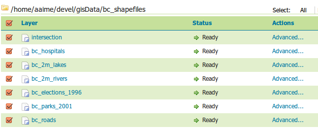
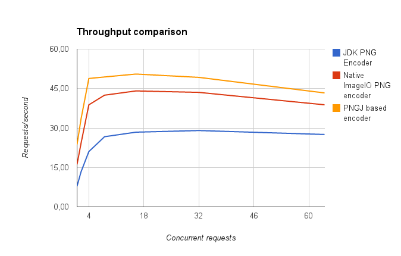
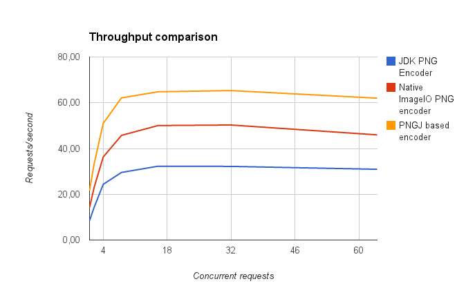
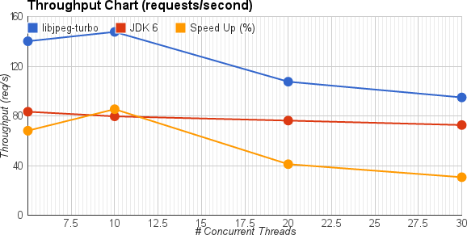
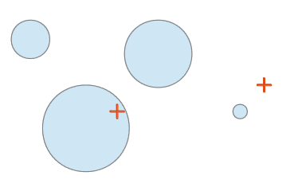
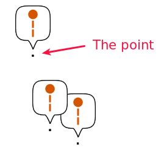

GeoServer team is pleased to announce the release of GeoServer 2.5-beta.

This release is packed with new features and interesting new extensions. Here is some reason why you should try 2.5.-beta.

**WCS 2.0 and WCS 2.0 EO**

GeoServer 2.5 is now shipping with WCS 2.0 as  a core module, a major improvement in terms of usability compared to both WCS 1.0 and WCS 1.1. For example, getting back the full raster is now as easy as:

http://localhost:8080/geoserver/wcs?request=GetCoverage&service=WCS&version=2.0.1&coverageId=nurc__Img_Sample

while getting the same, but with half the size, can be achieved using:

    
    http://localhost:8080/geoserver/wcs?request=GetCoverage&service=WCS&version=2.0.1&coverageId=nurc__Img_Sample&scaleFactor=0.5

Paired with the WCS 2.0 module we have the WCS 2.0 Earth Observation (EO) extension, which adds the ability to expose the time dimension using standard extensions to the base WCS 2.0 protocol.
We'd like to thank DLR and EUMESAT for sponsoring this work, and GeoSolutions for carrying it out on their behalf.

**Batch layer importer extension**

A new extension that allows for batch import of data, dubbed "the importer", is now also available. It supplements the existing GeoServer ui by adding a much more convenient workflow for layer configuration. For example previously configuring multiple Shapefiles (or multiple PostGIS tables) required users to tediously configure one by one. With the importer it can achieved with a few easy to follow steps. The importer is accessible from both the web ui and a REST api, making it easy to use in a variety of environments.

The importer also allows for consumption of formats that GeoServer does not support natively. Formats such as KML and CSV can be conveniently ingested into an existing data formats such as PostGIS and be efficiently served.

The importer was developed and contributed by Boundless. A special thanks to them and the [MapStory](http://mapstory.org/) project for providing most of the funding and requirements for the extension.

**WMS performance and quality improvements**

Going back to pre-existing protocols, let's have a look at WMS.

A new higher performance PNG encoder has been included in GeoServer. Based on the open source [PNGJ library](https://code.google.com/p/pngj/), and with special local optimizations to extract pixels for encoding with minimal overhead, the encoder provides a significant speedup over the encoder included in the JDK (that is, the one you get by default) and also over the ImageIO native extensions one (which is available on selected platforms, and requires you a separate installation). Here are some results comparing map thoughput using the FOSS4G WMS shootout test harness, using Oracle JDK, and then OpenJDK:

### 

_GetMap thoughput over Oracle JDK 7_

_GetMap thoughput over OpenJDK7_

Before you get overly excited, remember that this speedups were achieved because the PNG encoding had a major effect on this benchmark, which was drawing maps with rather light contents, if you have maps that take more than 200ms to be rendered the improvement will be difficult to notice by the naked eye (these chart show throughput, to have a reference, the slowest single threaded result in terms of response time was 120ms, for the JDK encoder based results).
The work on this topic was done by Andrea Aime in his spare time, but let's not forget to thank Hernan J. Gonzalez for the all work put in the PNGJ library.

Speaking of performance, if you are building maps with complex geometries on top of a PostGIS database you'll be happy to hear that we're now calling [ST_Simplify](http://www.postgis.org/docs/ST_Simplify.html) to get the geometries be simplified directly in the database, significantly reducing the time spent to transfer them. A benchmark drawing a large number (a few tens of thousands) of complex polygons in a small scale map went up from 7 r/s (requests per second) to 11 r/s (and yes, we made tests showing we are not slowing down when working on simpler geometries). Thanks to Andrea Aime for working on this, and Jonathan Moules for providing the data, styles and benchmark setup that led to this improvement.

And if you're interested in JPEG performance instead, just go and install the newly released JPEG Turbo extension, which allows GeoServer to leverage the excellent work done by the [libjpegturbo](http://libjpeg-turbo.virtualgl.org/) team to speed up JPEG encoding. Here is a benchmark Simone performed on a Windows 64 laptop using a well optimized image mosaic as the source (which notably cannot use the ImageIO native extensions to speed up image encoding):

Changing gear, you'll also be pleased to hear that point symbols are now rendered with higher quality and all at the same size/appearance, thanks to pixel precise casting of their position, and that we're suffering from reduced issues at tile borders, even if you don't manually specify a "border"/"gutter" parameter thanks to a much improved estimation of the symbols size (which is performed using static analyisis of the SLD).

**Improved GetFeatureInfo precision**

Most WMS servers available today, including GeoServer 2.4 and earlier, have a pretty simple mechanism to find out what you have clicked on a map:

	
  * decide on a search area, based either on a static configuration, or the size of the biggest symbol in the map being clicked

	
  * do a BBOX search on the data

This is fine and works well if your maps is made of regular symbols, that is, square enough, and more or less having a similar size. But what happens if your map looks like this, what will you get when you click outside of the small circle, or inside the large one? The two "clicks" onthe map below are at the same distance from the center point of the circles, but  one of the two will not work as it should, either you get a positive response from both of them, or no response, whilst you should get a response only with the large circle click.

The same goes if you are using irregular point symbols, or if you are using geometry transformations to offset them from the central point location, GetFeautureInfo might not respond as you like when clicking inside the symbol, because it's too far away from the actual geometry.

The problem in the end is pretty simple, the commonly used algorithm does not paint the map, so it cannot know how big the symbols will be in the particular area you clicked, nor be informed about their shape. That's what GeoServer 2.5 does instead, it figures out how much of the map it has to paint investigating the largest symbol in the map, and then actually paints it, quickly, to figure out what was actually available in the point you clicked: this way, you'll get only what you actually clicked (well, almost, there is still a small 3px tolerance, so if you click just outside of a circle, you'll get back the info about that circle anyways).

We're pretty excited about this new functionality, and believe you should be too. Let us know how it works on your maps.

Big thanks to the Eskilstuna municipality for funding the improvement, and GeoSolutions for carrying out the work.

**DXF extension**

Have a user base that loves CAD tools? This output format is for you then, it adds DXF output for WFS requests, and also for WPS ones, allowing vector data downloads in this common format. Special thanks to Mauro Bartolomeoli for the initial implementation, and for pushing the module up in supported land.

### **And more**

### The release packs also a hefty number of fixes and improvements that were not backported to the stable series yet, check out the [full release logs](The same goes if you are using irregular point symbols, or if you are using geometry transformations to offset them from the central point location.) for details.

**Let us know how it goes**

This is the beta release for the 2.5 series, and this is where the user community has the best occasion of influencing the 2.5 release by reporting all issues you find in the release. So please, go download the release, try it out, report issues, and help us create, next month, a very good release candidate

----

## GeoServer 2.5-beta

Released on Jan 20 2014

#### Download format

- [Binary (OS independent)](http://sourceforge.net/projects/geoserver/files/GeoServer/2.5-beta/geoserver-2.5-beta-bin.zip/download)
- [Web Archive](http://sourceforge.net/projects/geoserver/files/GeoServer/2.5-beta/geoserver-2.5-beta-war.zip)
- [Windows Installer](https://sourceforge.net/projects/geoserver/files/GeoServer/2.5-beta/geoserver-2.5-beta.exe/download)
- [Mac OS X Installer](https://sourceforge.net/projects/geoserver/files/GeoServer/2.5-beta/geoserver-2.5-beta.dmg/download)
- [Source Code](http://sourceforge.net/projects/geoserver/files/GeoServer/2.5-beta/geoserver-2.5-beta-src.zip)

#### Documentation

- [HTML Documentation](http://sourceforge.net/projects/geoserver/files/GeoServer/2.5-beta/geoserver-2.5-beta-htmldoc.zip)
- [API Documentation](http://sourceforge.net/projects/geoserver/files/GeoServer/2.5-beta/geoserver-2.5-beta-javadoc.zip)
- [Change Log](#release-notes)

#### Extensions

**Data store**

- [Application Schema](http://sourceforge.net/projects/geoserver/files/GeoServer%20Extensions/2.5-beta/geoserver-2.5-beta-app-schema-plugin.zip)
- [ArcSDE](http://sourceforge.net/projects/geoserver/files/GeoServer%20Extensions/2.5-beta/geoserver-2.5-beta-arcsde-plugin.zip)
- [DB2](http://sourceforge.net/projects/geoserver/files/GeoServer%20Extensions/2.5-beta/geoserver-2.5-beta-db2-plugin.zip)
- [H2](http://sourceforge.net/projects/geoserver/files/GeoServer%20Extensions/2.5-beta/geoserver-2.5-beta-h2-plugin.zip)
- [MySQL](http://sourceforge.net/projects/geoserver/files/GeoServer%20Extensions/2.5-beta/geoserver-2.5-beta-mysql-plugin.zip)
- [Oracle](http://sourceforge.net/projects/geoserver/files/GeoServer%20Extensions/2.5-beta/geoserver-2.5-beta-oracle-plugin.zip)
- [Pregeneralized features](http://sourceforge.net/projects/geoserver/files/GeoServer%20Extensions/2.5-beta/geoserver-2.5-beta-feature-pregeneralized-plugin.zip)
- [SQL Server](http://sourceforge.net/projects/geoserver/files/GeoServer%20Extensions/2.5-beta/geoserver-2.5-beta-sqlserver-plugin.zip)
- [Teradata](http://sourceforge.net/projects/geoserver/files/GeoServer%20Extensions/2.5-beta/geoserver-2.5-beta-teradata-plugin.zip)
- [VPF](http://sourceforge.net/projects/geoserver/files/GeoServer%20Extensions/2.5-beta/geoserver-2.5-beta-vpf-plugin.zip)
- [INSPIRE](http://sourceforge.net/projects/geoserver/files/GeoServer%20Extensions/2.5-beta/geoserver-2.5-beta-inspire-plugin.zip)

**Coverage store**

- [GDAL](http://sourceforge.net/projects/geoserver/files/GeoServer%20Extensions/2.5-beta/geoserver-2.5-beta-gdal-plugin.zip)
- [Image Pyramid](http://sourceforge.net/projects/geoserver/files/GeoServer%20Extensions/2.5-beta/geoserver-2.5-beta-pyramid-plugin.zip)
- [JPEG2000](http://sourceforge.net/projects/geoserver/files/GeoServer%20Extensions/2.5-beta/geoserver-2.5-beta-jp2k-plugin.zip)
- [JDBC Image Mosaic](http://sourceforge.net/projects/geoserver/files/GeoServer%20Extensions/2.5-beta/geoserver-2.5-beta-imagemosaic-jdbc-plugin.zip)

**Other**

- [Chart dynamic symbolizer](http://sourceforge.net/projects/geoserver/files/GeoServer%20Extensions/2.5-beta/geoserver-2.5-beta-charts-plugin.zip)
- [Control flow](http://sourceforge.net/projects/geoserver/files/GeoServer%20Extensions/2.5-beta/geoserver-2.5-beta-control-flow-plugin.zip)
- [Cross layer filtering](http://sourceforge.net/projects/geoserver/files/GeoServer%20Extensions/2.5-beta/geoserver-2.5-beta-querylayer-plugin.zip)
- [CSS styling](http://sourceforge.net/projects/geoserver/files/GeoServer%20Extensions/2.5-beta/geoserver-2.5-beta-css-plugin.zip)
- [Excel output format](http://sourceforge.net/projects/geoserver/files/GeoServer%20Extensions/2.5-beta/geoserver-2.5-beta-excel-plugin.zip)
- [GeoSearch](http://sourceforge.net/projects/geoserver/files/GeoServer%20Extensions/2.5-beta/geoserver-2.5-beta-geosearch-plugin.zip)
- [Image Map output format](http://sourceforge.net/projects/geoserver/files/GeoServer%20Extensions/2.5-beta/geoserver-2.5-beta-imagemap-plugin.zip)
- [OGR output format](http://sourceforge.net/projects/geoserver/files/GeoServer%20Extensions/2.5-beta/geoserver-2.5-beta-ogr-plugin.zip)
- [XSLT output format](http://sourceforge.net/projects/geoserver/files/GeoServer%20Extensions/2.5-beta/geoserver-2.5-beta-xslt-plugin.zip)
- [WPS](http://sourceforge.net/projects/geoserver/files/GeoServer%20Extensions/2.5-beta/geoserver-2.5-beta-wps-plugin.zip)
- [CAS](http://sourceforge.net/projects/geoserver/files/GeoServer%20Extensions/2.5-beta/geoserver-2.5-beta-cas-plugin.zip)
- Monitor ([Core](http://sourceforge.net/projects/geoserver/files/GeoServer%20Extensions/2.5-beta/geoserver-2.5-beta-monitor-plugin.zip), [Hibernate](http://sourceforge.net/projects/geoserver/files/GeoServer%20Extensions/2.5-beta/geoserver-2.5-beta-monitor-hibernate-plugin.zip))
- [CSW](http://sourceforge.net/projects/geoserver/files/GeoServer%20Extensions/2.5-beta/geoserver-2.5-beta-csw-plugin.zip)
- Importer ([Core](http://sourceforge.net/projects/geoserver/files/GeoServer%20Extensions/2.5-beta/geoserver-2.5-beta-importer-plugin.zip), [BerkeleyDB Backend](http://sourceforge.net/projects/geoserver/files/GeoServer%20Extensions/2.5-beta/geoserver-2.5-beta-importer-bdb-plugin.zip))
- [WCS 2.0 EO](http://sourceforge.net/projects/geoserver/files/GeoServer%20Extensions/2.5-beta/geoserver-2.5-beta-wcs2_0-eo-plugin.zip)
- [DXF output format for WFS/WPS](http://sourceforge.net/projects/geoserver/files/GeoServer%20Extensions/2.5-beta/geoserver-2.5-beta-dxf-plugin.zip)
- [WMS libJpegTurbo output format](http://sourceforge.net/projects/geoserver/files/GeoServer%20Extensions/2.5-beta/geoserver-2.5-beta-libjpeg-turbo-plugin.zip)

#### [JIRA](https://osgeo-org.atlassian.net/issues/?jql=project%3DGEOS)

JIRA Version 19552

## Release notes

New Feature:

* [GEOS-4976](https://osgeo-org.atlassian.net/browse/GEOS-4976) Add support for expire cache and expire clients rules for embedded gwc tile layers
* [GEOS-6294](https://osgeo-org.atlassian.net/browse/GEOS-6294) Graduate the importer module to extension status

Improvement:

* [GEOS-2029](https://osgeo-org.atlassian.net/browse/GEOS-2029) label grouping should group by label text AND by symbolizer
* [GEOS-3747](https://osgeo-org.atlassian.net/browse/GEOS-3747) Add LegendGraphic support for Rules in SLDs
* [GEOS-5813](https://osgeo-org.atlassian.net/browse/GEOS-5813) Add a RoleService implementation using LDAP as a source
* [GEOS-5992](https://osgeo-org.atlassian.net/browse/GEOS-5992) Searching for an unqualified layer should always give precedence to layers in the default workspace
* [GEOS-6025](https://osgeo-org.atlassian.net/browse/GEOS-6025) Allow login with sAMAccountName in ActiveDirectory LDAP
* [GEOS-6063](https://osgeo-org.atlassian.net/browse/GEOS-6063) Allow creation of imagemap for points using a wellknownname  different from circle
* [GEOS-6077](https://osgeo-org.atlassian.net/browse/GEOS-6077) Create an endpoint for webapps to authenticate against
* [GEOS-6080](https://osgeo-org.atlassian.net/browse/GEOS-6080) Allow loading of user roles from roleservice in J2EEAuthenticationFilter
* [GEOS-6088](https://osgeo-org.atlassian.net/browse/GEOS-6088) Add support for count in json output
* [GEOS-6089](https://osgeo-org.atlassian.net/browse/GEOS-6089) Enable WCS 1.0 support for WPS
* [GEOS-6104](https://osgeo-org.atlassian.net/browse/GEOS-6104) add featuretypename/tablename to exception message of spatial operations
* [GEOS-6143](https://osgeo-org.atlassian.net/browse/GEOS-6143) Remove out of date caveats from app-schema feature chaining documenation
* [GEOS-6206](https://osgeo-org.atlassian.net/browse/GEOS-6206) Prefix all geoserver jars with "gs-"
* [GEOS-6218](https://osgeo-org.atlassian.net/browse/GEOS-6218) Enable CSV outputFormat for complex features with SF0 schema
* [GEOS-6238](https://osgeo-org.atlassian.net/browse/GEOS-6238) Add attributes writing to dxf community module
* [GEOS-6243](https://osgeo-org.atlassian.net/browse/GEOS-6243) Allows configuring an empty ImageMosaic via REST
* [GEOS-6258](https://osgeo-org.atlassian.net/browse/GEOS-6258) GeoWebCache 304 responses treated as errors by monitoring extension
* [GEOS-6265](https://osgeo-org.atlassian.net/browse/GEOS-6265) Allow integrated GWC to cascade WMS requests (other than GetMap) just like a stand alone one
* [GEOS-6274](https://osgeo-org.atlassian.net/browse/GEOS-6274) Graduate WCS 2.0 EO module to extension status
* [GEOS-6275](https://osgeo-org.atlassian.net/browse/GEOS-6275) [WPS CORE] - Improve the GeoTIFF PPIO Tiling Management
* [GEOS-6276](https://osgeo-org.atlassian.net/browse/GEOS-6276) GridCoverage2DRIA improvements
* [GEOS-6283](https://osgeo-org.atlassian.net/browse/GEOS-6283) Graduate libjpeg-turbo community module to extension status

Bug:

* [GEOS-2909](https://osgeo-org.atlassian.net/browse/GEOS-2909) Grouped labels are always drawn before non grouped ones, breaking natural layer ordering
* [GEOS-4103](https://osgeo-org.atlassian.net/browse/GEOS-4103) GeoWebCache not working for GetLegendGraphic requests
* [GEOS-4601](https://osgeo-org.atlassian.net/browse/GEOS-4601) Point Symbolizer ExternalGraphic  rendering problem
* [GEOS-5054](https://osgeo-org.atlassian.net/browse/GEOS-5054) Role lookup fails on secured LDAP servers
* [GEOS-5114](https://osgeo-org.atlassian.net/browse/GEOS-5114) GeoServer generates invalid PNG files when using raster symbolizers with extended color map
* [GEOS-5516](https://osgeo-org.atlassian.net/browse/GEOS-5516) GetFeatureInfo fails against 3D data
* [GEOS-5531](https://osgeo-org.atlassian.net/browse/GEOS-5531) WMTS Get Capabilities - missing return character
* [GEOS-5643](https://osgeo-org.atlassian.net/browse/GEOS-5643) problem with legend decoration and input parameter
* [GEOS-5920](https://osgeo-org.atlassian.net/browse/GEOS-5920) CSS module does not seem to be unit aware
* [GEOS-5972](https://osgeo-org.atlassian.net/browse/GEOS-5972) GeoServer cannot be started without web jars, in particular web-security removal prevents startup
* [GEOS-5988](https://osgeo-org.atlassian.net/browse/GEOS-5988) CSW spatial filters checks are too simplistic, do not work with a deeply nested schema
* [GEOS-5997](https://osgeo-org.atlassian.net/browse/GEOS-5997) Basic authentication filter message digest is not thread safe
* [GEOS-6000](https://osgeo-org.atlassian.net/browse/GEOS-6000) LRUAuthenticationCacheImpl TimerTask causes deadlock
* [GEOS-6007](https://osgeo-org.atlassian.net/browse/GEOS-6007) WFS bbox filters with the 5th srs parameter will loose the srsName if the CRS cannot be turned back into a code (e.g., AUTO:xyzw projections)
* [GEOS-6019](https://osgeo-org.atlassian.net/browse/GEOS-6019) GetFeatureInfo with reprojection fails
* [GEOS-6042](https://osgeo-org.atlassian.net/browse/GEOS-6042) NPE in monitoring module while handling a KML reflector
* [GEOS-6047](https://osgeo-org.atlassian.net/browse/GEOS-6047) dependency for community importer-bdb module com.sleepycat:je:jar:4.1.10 not found in repositories
* [GEOS-6062](https://osgeo-org.atlassian.net/browse/GEOS-6062) When using an empty Abstract in SLD an exception is thrown
* [GEOS-6072](https://osgeo-org.atlassian.net/browse/GEOS-6072) Printing plugin misses Xerces JAR
* [GEOS-6074](https://osgeo-org.atlassian.net/browse/GEOS-6074) Build failure in wms GetMapKvpRequestReaderTest in path with spaces
* [GEOS-6092](https://osgeo-org.atlassian.net/browse/GEOS-6092) WFS 2.0 GetFeature ignores the feature bounding settings
* [GEOS-6098](https://osgeo-org.atlassian.net/browse/GEOS-6098) Creation of SQL-View Layer fails due to comment in the last line
* [GEOS-6126](https://osgeo-org.atlassian.net/browse/GEOS-6126) JP2K Extension is missing as a profile in web/app
* [GEOS-6152](https://osgeo-org.atlassian.net/browse/GEOS-6152) Update download links pointing to old gridlock site to ares.boundlessgeo.org
* [GEOS-6193](https://osgeo-org.atlassian.net/browse/GEOS-6193) LDAP test connection is broken when using userGroupService
* [GEOS-6208](https://osgeo-org.atlassian.net/browse/GEOS-6208) Make the PNGJ based encoder the default PNG encoder
* [GEOS-6209](https://osgeo-org.atlassian.net/browse/GEOS-6209) Fees and AccessContraints should be set to "none" when there are no constraints
* [GEOS-6219](https://osgeo-org.atlassian.net/browse/GEOS-6219) Fix DXF community module build and add it to the nightly builds
* [GEOS-6221](https://osgeo-org.atlassian.net/browse/GEOS-6221) Have GetFeatureInfo report what the user really clicked onto (taking into account symbol shapes and the like)
* [GEOS-6222](https://osgeo-org.atlassian.net/browse/GEOS-6222) Build failure in gt-app-schema-test caused by change for [GEOT-4634] MetaBufferEstimator won't give the right response if a Mark is used, but its size is not specified
* [GEOS-6248](https://osgeo-org.atlassian.net/browse/GEOS-6248) [Point Symbolizer ExternalGraphic rendering problem_new new]
* [GEOS-6253](https://osgeo-org.atlassian.net/browse/GEOS-6253) TMS - request fails for PNG8 but works for PNG
* [GEOS-6262](https://osgeo-org.atlassian.net/browse/GEOS-6262) GeoWebCache REST api /masstruncate is not working
* [GEOS-6264](https://osgeo-org.atlassian.net/browse/GEOS-6264) Graduate WCS 2.0 to core module
* [GEOS-6288](https://osgeo-org.atlassian.net/browse/GEOS-6288) move dxf docs from community to extensions
* [GEOS-6298](https://osgeo-org.atlassian.net/browse/GEOS-6298) Build failure in gs-importer CSVDataStoreTest caused by bad URL`<->`File conversion

Task:

* [GEOS-6261](https://osgeo-org.atlassian.net/browse/GEOS-6261) Promote dxf community module to extension

Wish:

* [GEOS-3561](https://osgeo-org.atlassian.net/browse/GEOS-3561) Disabling the GeoServer console
