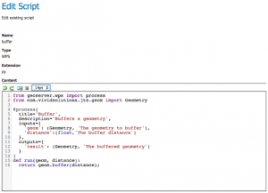

The GeoServer team is pleased to account the greatly anticipated 2.6.0 release. This release is now available for [download](http://geoserver.org/release/2.6.0/) with [zip](http://sourceforge.net/projects/geoserver/files/GeoServer/2.6.0/geoserver-2.6.0-bin.zip), [war](http://sourceforge.net/projects/geoserver/files/GeoServer/2.6.0/geoserver-2.6.0-war.zip), [dmg](http://sourceforge.net/projects/geoserver/files/GeoServer/2.6.0/geoserver-2.6.0.dmg) and [exe](http://sourceforge.net/projects/geoserver/files/GeoServer/2.6.0/geoserver-2.6.0.exe) bundles available (see the [change log](#release-notes) for details on last minute fixes).

Thanks to the user list for testing the 2.6-beta and 2.6-RC1, this collaboration and testing really helped smooth our migration to Java 7. The [Code Sprint ]()at FOSS4G was able to fill in gaps testing oracle curve support, the marlin extension on a range of platforms, and providing [documentation](http://docs.geoserver.org/latest/en/user/styling/sld-extensions/pointsymbols.html#shape-symbols) introducing wind barbs and inline custom marks.

Thanks to Ian Turton, Jody Garnett and Kevin Smith for assisting in this release. This release is made in conjunction with GeoTools 12.0.

### Java 7

_Ensure you are using Oracle o OpenJDK Java 7._

Support for Java 7 is not only a new feature for GeoServer 2.6.0 - **Java 7 is a requirement**.

The [installation](http://docs.geoserver.org/latest/en/user/installation/java.html) instructions have been updated for windows, mac and linux users. Mac users will have an easy upgrade as GeoServer.app includes an appropriate Java 7 virtual machine.

### New and Improved

New functionality:

	
  * **WFS Cascade: **WFS Cascade has been updated to use a brand new GeoTools wfs client implementation.

	
  * **Curve support for GML and WMS:** GeoServer curve support has been added for interaction with Oracle Spatial. To configure look for Linearization tolerance when configuring your layer. As outlined in the FOSS4G presentation we are seeking interested parties to implement or fund curve support for PostGIS and SQL Server.

	
  * **Advanced Projection Handling:** Considerable care has been taken in the handling of raster data across the dateline and in polar projections.

	
  * **Coverage Views: **recombine bands from different sources into a multi-band coverage (use "configure new coverage view" when creating a new layer).

	
  * **Vector footprints support in image mosaics**: you can now cut out of your images the "bad" parts using vector footprints, setup as sidecar wkb/wkt files, or as a global footprints shapefile

	
  * **Pluggable Styles: **this change allows greater integration with the CSS Extension (and opens the door for even more style languages in the future)

	
  * **Wind Barbs and WKT Graphics:** for [greater creative control](http://docs.geoserver.org/latest/en/user/styling/sld-extensions/pointsymbols.html#shape-symbols).

	
  * **Printing: **new implementation from our friends at MapFish (based on MapFish 2.x).

	
  * **Scripting community module: **a great new editor for editing scripts directly from the web application

	
  * **New raster formats:** NetCDF and GRIB support, for anyone dealing with multidimensional data. NetCDF is also supported as a WCS output format, and it allows to extract data hypercubes out of your WCS server. Finally, it is also possible to build multidimensional mosaics of NetCDF and GRIB files, and add to the using the harvest REST API.

	
  * **Language and Internationalisation:** Turkish support has been added and French, Korean, Polish, Romanian are all caught up with the latest developments. Spot a translation mistake? Help translate here: [GeoServer Latest localizations](https://www.transifex.com/projects/p/geoserver/)

## About GeoServer 2.6

Articles and resources for GeoServer 2.6 series:

	
  * [GeoServer at FOSS4G]()

	
    * [State of GeoServer and GeoTools 2014](http://vimeo.com/106835755) ([slides](http://www.slideshare.net/jgarnett/state-of-geoserver-geotools-and-friends-2014))

	
  * [Raster Views in GeoServer via the CoverageView concept](http://www.geo-solutions.it/blog/overageview-concept-for-geoserver/) (GeoSolutions)

	
  * [Advanced Raster Projection in GeoServer](http://www.geo-solutions.it/blog/developers-corner-advanced-raster-projection-geoserver/) (GeoSolutions)

	
  * [Supporting Wind Barbs In GeoServer and GeoTools](http://www.geo-solutions.it/blog/developers-corner-supporting-wind-barbs-geoserver-geotools/) (GeoSolutions)

	
  * [GeoServer now supports Vector Footprints for ImageMosaic](http://www.geo-solutions.it/blog/geoserver-supports-footprints-imagemosaic/) (GeoSolutions)

	
  * [2.6-RC1 announcement]() and [change log](#release-notes)

	
  * [2.6-beta announcement]() and [change log](#release-notes)

## Release notes

Improvement:

* [GEOS-5683](https://osgeo-org.atlassian.net/browse/GEOS-5683) [PATCH] Implementation of OtherSRS for WFS getCapabilities as a global srs-list

Bug:

* [GEOS-5571](https://osgeo-org.atlassian.net/browse/GEOS-5571) GwcSettingsPage WicketException if the user adds a new standard gridset
* [GEOS-6245](https://osgeo-org.atlassian.net/browse/GEOS-6245) Not reporting correct style width/height in GetCaps
* [GEOS-6311](https://osgeo-org.atlassian.net/browse/GEOS-6311) Managed File API
* [GEOS-6379](https://osgeo-org.atlassian.net/browse/GEOS-6379) Unable to add new default gridsets
* [GEOS-6407](https://osgeo-org.atlassian.net/browse/GEOS-6407) Exception thrown when running GeoServer with INSPIRE plugin in Tomcat
* [GEOS-6468](https://osgeo-org.atlassian.net/browse/GEOS-6468) GWC's GeoServerLifecycleHandler fails to be created and causes datastores not to be disposed
* [GEOS-6587](https://osgeo-org.atlassian.net/browse/GEOS-6587) Installer should set start.bat to run as Administrator
* [GEOS-6625](https://osgeo-org.atlassian.net/browse/GEOS-6625) WMS 1.3 request against shapefile fails during rendering
* [GEOS-6628](https://osgeo-org.atlassian.net/browse/GEOS-6628) NullPointerException when setting empty ParameterFilter in the Layer Caching Panel
* [GEOS-6631](https://osgeo-org.atlassian.net/browse/GEOS-6631) WMS GetFeatureInfo throws NullPointerException with info_format=application/json
* [GEOS-6632](https://osgeo-org.atlassian.net/browse/GEOS-6632) Cross-site scripting vulnerability in WMS exceptions
* [GEOS-6638](https://osgeo-org.atlassian.net/browse/GEOS-6638) DescribeEOCoverageSet returns invalid XML on coverageViews. Afterwards the WCS 2.0.1 GetCapabilities and DescribeCoverage request does not work
* [GEOS-6641](https://osgeo-org.atlassian.net/browse/GEOS-6641) WCS Helper gridCoverageRequests multidim splitter doesn't close Featureiterator
* [GEOS-6642](https://osgeo-org.atlassian.net/browse/GEOS-6642) NetCDF ouput on Coverage Views may throws exceptions when dealing with input bands coming from different input files
* [GEOS-6643](https://osgeo-org.atlassian.net/browse/GEOS-6643) Integrate OL3 into map preview
* [GEOS-6645](https://osgeo-org.atlassian.net/browse/GEOS-6645) NPE when trying to reload bands with empty range
* [GEOS-6647](https://osgeo-org.atlassian.net/browse/GEOS-6647) Failure to generate WMS capabilities document when cascading a WMS server that does not advertise GetFeatureInfo
* [GEOS-6648](https://osgeo-org.atlassian.net/browse/GEOS-6648) WCS 2.0 GetCoverage with gml output does not properly setup the UoM and noData values configured in the bands
* [GEOS-6649](https://osgeo-org.atlassian.net/browse/GEOS-6649) Update headers to (c) OSGeo
* [GEOS-6651](https://osgeo-org.atlassian.net/browse/GEOS-6651) ImageMosaic layers do not show images when version=1.3.0
* [GEOS-6663](https://osgeo-org.atlassian.net/browse/GEOS-6663) RestConfig StyleTests fail due to file locking on Windows
* [GEOS-6664](https://osgeo-org.atlassian.net/browse/GEOS-6664) OWS FilePublisher test fails on Windows due to file encoding issues.
* [GEOS-6669](https://osgeo-org.atlassian.net/browse/GEOS-6669) CSS Style destroyed when using "CSS Styles" page
* [GEOS-6674](https://osgeo-org.atlassian.net/browse/GEOS-6674) Cascading images in CRS other than their native ones
* [GEOS-6676](https://osgeo-org.atlassian.net/browse/GEOS-6676) Scripting app resource throws null pointer exception if main script isn't found
* [GEOS-6679](https://osgeo-org.atlassian.net/browse/GEOS-6679) WCS20 GetCoverage multipart does encoding 2 times
* [GEOS-6684](https://osgeo-org.atlassian.net/browse/GEOS-6684) WPS Metadata title is hardcoded (WPSInfo.getTitle always returns Prototype GeoServer WPS)
