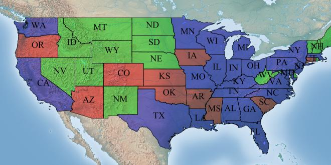
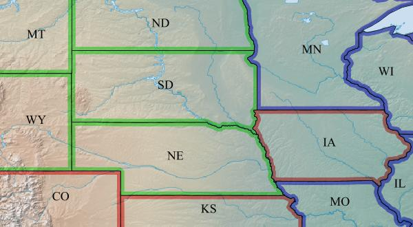
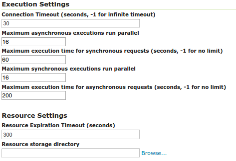
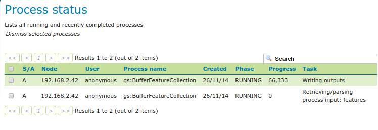
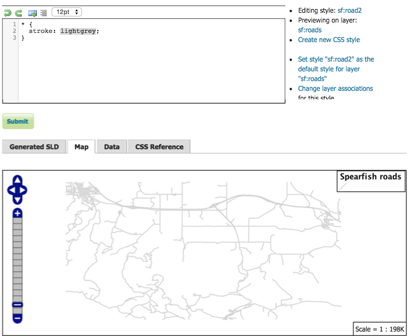

The GeoServer team is excited to announce the release of GeoServer [2.7-beta](http://geoserver.org/release/2.7-beta/) with some great new features. The download page for [2.7-beta](http://geoserver.org/release/2.7-beta/) provides links for [zip](http://sourceforge.net/projects/geoserver/files/GeoServer/2.7-beta/geoserver-2.7-beta-bin.zip), [war](http://sourceforge.net/projects/geoserver/files/GeoServer/2.7-beta/geoserver-2.7-beta-war.zip), [dmg](http://sourceforge.net/projects/geoserver/files/GeoServer/2.7-beta/geoserver-2.7-beta.dmg) and [exe](http://sourceforge.net/projects/geoserver/files/GeoServer/2.7-beta/geoserver-2.7-beta.exe) bundles. As a development release, 2.7-beta is considered experimental and is provided for testing purposes. This release is not recommended for production (even if you are enthusiastic by the new features).

This release is made in conjunction with GeoTools 13-beta.  Thanks Jody (and Boundless Victoria) for making this release, Kevin for GeoWebCache 1.7-beta, and a big thanks to Andrea for gathering up the contents (and pictures) for this blog post.

A complete [change log](#release-notes) is available from the issue tracker.

### Please Download and Test

The committers have a great release for you to look forward to, we would like to ask you to **download and test**. By trying GeoServer out on a wide range of platforms and datasets we can all help the next release be great.

> _Testing is a key part of the open source [social contract](http://www.how2map.com/2013/09/opensource-and-social-contract.html). This is your best chance to identify issues early while we still have time to do something about it. If you make use [commercial support](http://geoserver.org/support/) ask your vendor about their plans for 2.7-beta testing._

When testing Geoserver 2.7-beta please let us know on the [user list](http://geoserver.org/comm/) how it works for you. We will be sure to thank you in the final release announcement and product presentations.

## New Features

### Color composition and blending

Color composition and blending are two new extensions to SLD allowing the web map styler to control how overlapping layers in a map are merged together. Beyond the simple stacking and translucency control a wide range of effects are now possible by allowing masking and specific color operations for blending layers together in new ways.

A common well known example is a polygon thematic map on top of a DEM, which tends to provide under-par results using only transparency control, but generates very appealing ones when using the "multiply" blending mode:

Alpha masking also allows for neat cartographic tricks, like the one below, where the polygon fill has been cut at the border of the states generating a "inner line" effect:

Check out the documentation for a [list of supported operations and some examples](http://docs.geoserver.org/latest/en/user/styling/sld-extensions/composite-blend.html). We would like to thank [Cleveland Metroparks](http://www.clevelandmetroparks.com/) for sponsoring this improvement.

### WPS Clustering

First of, [GSIP 119](https://github.com/geoserver/geoserver/wiki/GSIP%20119%20WPS%20clustering%20of%20asynchronous%20requests) added support for asynchronous requests over a cluster of GeoServer instances. In WPS an asynchronous request starts by returning the client a URL that can be polled in order to know about the execution progress, and eventually to retrieve the final results.  Previous to 2.7-beta the status information was kept in memory, thus only the GeoServer instance running the process could meaningfully respond to a poll from the client. With GeoServer 2.7-beta a new extension point allows the programmer to create a process status repository that can be shared among the GeoServer instances.

The first default implementation of the shared repository is a [Hazelcast based one](http://docs.geoserver.org/latest/en/user/extensions/wps/hazelcast-clustering.html), leveraging in-memory, replicated and distributed maps to share the state information, while the results (which can be pretty large) are stored in a shared file system. The community is welcomed to develop other variants that could store the information in other places, for example, a relational database, a nosql one, or in the clould (e.g., S3 storage).

### WPS Security

[GSIP 121](https://github.com/geoserver/geoserver/wiki/GSIP-121) added the ability to provide fine grained access control to processes based on our usual role based authentication system: each process or group of processes can be associated to a list of roles that can access them, while other users will be disallowed seeing or accessing the same processes.

### WPS Limits

Integrating with the security, [GSIP 123](https://github.com/geoserver/geoserver/wiki/GSIP%20123%20WPS%20input%20and%20execution%20limits) added support for process execution limits, bringing WPS up to par with the other OGC services in terms of limiting the resources used by a single request. In the main WPS panel one can now configure how much processing time to give synchronous and asynchronous requests:

Also, in the new process security page one can configure a global limit for the size of complex inputs (see above), it is also possible to configure limits on a process by process basis, in order to restrict the size of inputs, the range of numerical values, and the multiplicity of repeatable inputs, to constrain the effort of a WPS process call. All these limits will be dutifully reflected in the DescribeProcess output.

If you're not satisfied with the above limits and would like to develop new ones, no worries, the current code is setup on a pluggable WPSInputValidator extesion point that will allow you to create new types of input validators.

### WPS Dismiss

The final Finally, [GSIP 122](https://github.com/geoserver/geoserver/wiki/GSIP%20122%20Dismissing%20WPS%201.0%20process%20execution) added the ability to dismiss an ongoing process from the client that requested the execution, or as an administrator. The new Dismiss operation comes from the WPS 2.0 specification, which GeoServer does not support yet, so it has to be seen as a vendor extension to WPS 1.0, which leverages the executionId parameter returned in the asynch status links to allow execution cancellation, you can read more about it in the [user documentation](http://docs.geoserver.org/latest/en/user/extensions/wps/operations.html#dismiss). The administrator instead gets a new user interface panel showing the currently running operations, allowing selection and forceful dismissal of processes that are running:

[The user guide](http://docs.geoserver.org/latest/en/user/extensions/wps/administration.html#process-status-page) contains more details about its usage. We would like to thank [NATO STO CMRE](http://www.cmre.nato.int/) for sponsoring all the above WPS improvements.

### Refresh of the CSS module

The initial CSS extension (responsible for using CSS to generate SLD styles) was written in Scala. Although wildly popular, and featured up until GeoServer 2.6, the module has not been maintained to the level expected of a GeoServer extension.

Andrea has taken it unto himself to address this gap, rewriting the functionality in Java and making the result available to the GeoTools library.

The new CSS engine performs the same function as the Scala original and has managed to make a few key improvements. In particular the Java implementation can efficiently handle large CSS files without bogging down with minutes of translation time.

The user interface for the CSS editor has also been revamped a bit, making better usage of available screen space, and sporting syntax highlighting and formatting thanks to CodeMirror. This change addresses a common gripes correctly supporting relative images (the generated SLD preserves the relative path) and polygon with strokes are now translated to a single polygon symbolizer (to the benefit of GetLegendGraphic calls). Finally, you'll notice that the download size have been significantly trimmed, as we don't need anymore the Scala runtime.

The new translator has been tested against a few hundreds CSS styles already, but of course it's new, so it's of paramount importance that you test your own styles, and let us know if you notice any regression.

We take the occasion to thank David Window for creating the initial CSS module, and Andrea Aime for porting it to java and acting as the new maintainer.

### Relative time support in WMS/WCS

As you probably knows GeoServer supports time based filtering in both WMS (aka WMS-T) and WCS (as part of WCS-EO). Up until now you had to specify the desired time either as an absolute value, e.g. &time=2011-05-02, or as an absolute range of values, e.g. &time=2011-05-02/2011-05-05.

The work done in [GSIP 124](https://github.com/geoserver/geoserver/wiki/GSIP-124) adds support for a vendor specific extension to the time syntax which allows the specification of relative times, e.g., the last 36 hours, "PT36H/PRESENT", or the day after Decembre 25 2012, "2010-12-25T00:00:00.0Z/P1D".

This allows for more compact requests, but more importantly, it allows to generate stable, publishable links to instants or intervals relative to the present server time, e.g., the wheather forecast for tomorrow, two days and three days in the future, or the temperature maps for the last three days, maybe in a KML document generated with animations over time.

### Miscellaneous

In addition a wide range of improvements have been made:

	
  * For those into printed-maps, we added a new[ vendor parameter](http://docs.geoserver.org/latest/en/user/services/wms/vendor.html#scalemethod) forcing GeoServer to ignore the WMS simple scale computation algorithm, and run a local and accurate one instead, resulting in better integration between printing requirements and maps with scale dependencies.

	
  * The flow-control module now also supports [rate based rules](http://docs.geoserver.org/latest/en/user/extensions/controlflow/index.html#per-user-rate-control), with the ability to slow down, or simply reject, requests that are incoming from a specific client at an excessive rate.

	
  * For those working at the dateline, you'll be pleased to know that the WCS 2.0 GetCoverage requests can now handle bounding boxes crossing the dateline, and they will take the two halves of your coverage from the antipodes, merge them together in a single output file that will be returned to you (much like the same support for WMS, introduced in 2.6.0).

	
  * For people playing with configuration in the database, the JDBCConfig module and core modules have seen a number of changes to increase scalability and push down into the database as much filtering as possible in a larger number of commonly used code paths.

	
  * The DDS module, allowing extraction of DEM portions using the WMS protocol in order to feed Nasa Worldwind, has seen a number of fixes and now allows the specification of a texture compression format.

	
  * Finally, the map preview has been switched to OpenLayers 3, although the nostalgic can get back the OL2 based one by adding the "-DENABLE_OL3=false" parameter to the JVM startup options. Thanks to Bart for helping add this to GeoServer.

This concludes the most visible changes, if you are missing some please check the [full changelog](#release-notes) for details, there is quite a bit more stuff in there.

## Community modules

In addition to the core GeoServer and extensions we have an active community area for experiments and new volunteers. This release comes with a number of new community modules that you might find useful.

#### Clustering modules

The community section now holds two clustering modules allowing a cluster of GeoServer instances to work against a shared vision of the data directory.

The first one, contributed by GeoSolutions, works using J2EE JMS messages to share the state against the various nodes, and allows the usage of the normal file based configuration, either in a shared data dir mode, or data dir per node mode. This is know as the "JMS clustering", [see the documentation](http://docs.geoserver.org/latest/en/user/community/jms-cluster/index.html) for more details. The module is ready for testing as it's part of the [nightly builds](http://ares.boundlessgeo.com/geoserver/master/community-latest/).

The second one, contributed by Boundless, works by using Hazelcast distributed messages, and it's designed to work best against the JDBConfig module. At this time there are no released artifacts or documentation, but the adventurous user will find it pretty easy to figure out.

#### GeoFence

The GeoFence advanced security subsystem has been donated to the GeoServer project by GeoSolutions earlier this year, this module is the plugin connecting a GeoServer instance to the GeoFence rule engine.

GeoFence allows to setup complex security rules and leverage the full power of the underlying GeoServer security subsystem, for example, it's possible to establish security rules mixing in the same condition data and service being used, limit attributes available to certain users/operations, filter data so that certain records are not visible to the public, force certain default style to given user roles, and so on. The [GeoFence wiki](https://github.com/geoserver/geofence/wiki) contains documentation on how to use and configure the system.

**SOLR data store**

The SOLR data store makes GeoServer connect to a SOLR server and publish its spatial document via the OGC protocols, efficiently making maps, serving them via the WFS service, and allowing spatial analysis via WPS. The user interface allows to classify sets of documents as layers, and map the document variable structure into the fixed structure of simple feature types served by GeoServer.

You can read an introduction in [this blog post](http://www.geo-solutions.it/blog/solr-power-shining-through-geoserver-ogc-services/), and delve into details in the user [documentation](http://docs.geoserver.org/latest/en/user/community/solr/index.html).

### New WPS output formats

The gs-gpx and gs-kml modules offer two new PPIO to translate feature collection resulting off WPS processes in the respective formats. The KML one, in particular, also supports limited input parsing, allowing to send KML documents as inputs to the WPS services.

#### The WPS download process

The wps-download community module forms the basis of an "advanced clip and ship" tool that allows a client to ask for data in a specific area, eventually reprojecting it, estimate the download size, and allow the preparazion of a zip package with the desired data, all via asynchronous calls, providing a good replacement for WFS/WCS when the amount of data to be extracted is too large to be delivered via synchronous HTTP calls.

## About GeoServer 2.7

Articles and resources for GeoServer 2.7 series:

	
  * **[SOLR power shining through GeoServer OGC services](http://www.geo-solutions.it/blog/solr-power-shining-through-geoserver-ogc-services/)**

## Release notes

New Feature:

* [GEOS-2420](https://osgeo-org.atlassian.net/browse/GEOS-2420) Add support to limit WPS resource consuption
* [GEOS-6600](https://osgeo-org.atlassian.net/browse/GEOS-6600) Allow clients to decide whether to use the OGC simplified scale computation, or an accurate one
* [GEOS-6652](https://osgeo-org.atlassian.net/browse/GEOS-6652) Create a WPS KML encoder
* [GEOS-6680](https://osgeo-org.atlassian.net/browse/GEOS-6680) Creation of a new wps process for downloading vector and raster data as zip
* [GEOS-6705](https://osgeo-org.atlassian.net/browse/GEOS-6705) JMS based clustering module
* [GEOS-6706](https://osgeo-org.atlassian.net/browse/GEOS-6706) WPS should allow inline binary content in requests using base64 encoding
* [GEOS-6713](https://osgeo-org.atlassian.net/browse/GEOS-6713) GeoFence integration community module
* [GEOS-6736](https://osgeo-org.atlassian.net/browse/GEOS-6736) Allow admin to secure WPS processes based on current user roles
* [GEOS-6755](https://osgeo-org.atlassian.net/browse/GEOS-6755) GSIP 119 - WPS clustering of asynchronous requests
* [GEOS-6764](https://osgeo-org.atlassian.net/browse/GEOS-6764) Ability to cancel/dismiss asynchronous WPS processes still executing in the server
* [GEOS-6838](https://osgeo-org.atlassian.net/browse/GEOS-6838) Add support for color composition/blending in WMS

Improvement:

* [GEOS-4607](https://osgeo-org.atlassian.net/browse/GEOS-4607) Extended the scale line so that you can choose if you want to show the borders of the rectangle and which unit you want.
* [GEOS-5976](https://osgeo-org.atlassian.net/browse/GEOS-5976) Be able to add one or more DataURLs to any WMS layer
* [GEOS-6094](https://osgeo-org.atlassian.net/browse/GEOS-6094) Add text/xml and GML subtype info_format for WMS GetFeatureInfo
* [GEOS-6603](https://osgeo-org.atlassian.net/browse/GEOS-6603) Add a button for disabling native warp
* [GEOS-6622](https://osgeo-org.atlassian.net/browse/GEOS-6622) Add support for WCS 2.0 requests crossing the dateline
* [GEOS-6655](https://osgeo-org.atlassian.net/browse/GEOS-6655) Add text/xml MIME-types to WMS
* [GEOS-6681](https://osgeo-org.atlassian.net/browse/GEOS-6681) New REST GET parameter for disabling exception logging when 404 is returned
* [GEOS-6683](https://osgeo-org.atlassian.net/browse/GEOS-6683) Ignore numberMatched per layer for large queries
* [GEOS-6694](https://osgeo-org.atlassian.net/browse/GEOS-6694) Add support for binary base64 encoding in Execute requests
* [GEOS-6699](https://osgeo-org.atlassian.net/browse/GEOS-6699) Add a FeatureTypeCallback extension point to allow creation/flush of configured feature types in stores
* [GEOS-6700](https://osgeo-org.atlassian.net/browse/GEOS-6700) Add GUI integration for the SOLR data store
* [GEOS-6708](https://osgeo-org.atlassian.net/browse/GEOS-6708) Allow GeoPkg datastore to create data stores relative to data directory.
* [GEOS-6711](https://osgeo-org.atlassian.net/browse/GEOS-6711) Introduce mapper parameters and webservice based mapper in authkey
* [GEOS-6712](https://osgeo-org.atlassian.net/browse/GEOS-6712) Add charset definition in HTTP headers when returning text based responses
* [GEOS-6718](https://osgeo-org.atlassian.net/browse/GEOS-6718) Allow the admin to specify which SOLR geometry attribute should be the default one
* [GEOS-6729](https://osgeo-org.atlassian.net/browse/GEOS-6729) Add a flow control provider notion allowing extension to setup different flow controllers per user/request
* [GEOS-6730](https://osgeo-org.atlassian.net/browse/GEOS-6730) Allow request rate limits in control flow extension
* [GEOS-6731](https://osgeo-org.atlassian.net/browse/GEOS-6731) Add response headers to make delays evident
* [GEOS-6734](https://osgeo-org.atlassian.net/browse/GEOS-6734) GZIP Compression Filter does not take into account GML output
* [GEOS-6753](https://osgeo-org.atlassian.net/browse/GEOS-6753) Flexible Authentication Filter for gathering credentials from request headers
* [GEOS-6759](https://osgeo-org.atlassian.net/browse/GEOS-6759) Add support for OverviewManagement in WCS2.0 getCoverage requests
* [GEOS-6770](https://osgeo-org.atlassian.net/browse/GEOS-6770) Allow flow controllers access to the current Operation
* [GEOS-6771](https://osgeo-org.atlassian.net/browse/GEOS-6771) wmsGetFeatureInfo Request in 2.5, 2.6 doesnt work on TextSymbolizers
* [GEOS-6800](https://osgeo-org.atlassian.net/browse/GEOS-6800) sldservice: improvements to docs, tests and some bugfixes
* [GEOS-6803](https://osgeo-org.atlassian.net/browse/GEOS-6803) Add a system variable to disable advanced raster projection  for direct raster rendering
* [GEOS-6805](https://osgeo-org.atlassian.net/browse/GEOS-6805) Support for WCS 2.0 request without defining workspace in coverageId
* [GEOS-6808](https://osgeo-org.atlassian.net/browse/GEOS-6808) WCS-EO DescribeEOCoverageSet should be more lenient about time parsing
* [GEOS-6809](https://osgeo-org.atlassian.net/browse/GEOS-6809) WCS 2.0 DescribeCoverage should be able to handle single granules
* [GEOS-6815](https://osgeo-org.atlassian.net/browse/GEOS-6815) Add syntax highlighting to CSS editor
* [GEOS-6816](https://osgeo-org.atlassian.net/browse/GEOS-6816) CSS module generates separate stroke and polygon symbolizers when a single polygon symbolizer would do
* [GEOS-6817](https://osgeo-org.atlassian.net/browse/GEOS-6817) CSS Rule title combination is language dependent
* [GEOS-6826](https://osgeo-org.atlassian.net/browse/GEOS-6826) Update importer to use CsvDataStore backported to GeoTools

Bug:

* [GEOS-5787](https://osgeo-org.atlassian.net/browse/GEOS-5787) GetFeatureInfo HTTP Response header do not contain charset definition if format is text/plain
* [GEOS-5917](https://osgeo-org.atlassian.net/browse/GEOS-5917) Scale rules using >= or <= fail to translate in CSS
* [GEOS-5919](https://osgeo-org.atlassian.net/browse/GEOS-5919) CSS translator fails to handle incomplete scale ranged rules
* [GEOS-5994](https://osgeo-org.atlassian.net/browse/GEOS-5994) WCS 1.1.1 capabilities schemaLocation does not contain namespace
* [GEOS-6229](https://osgeo-org.atlassian.net/browse/GEOS-6229) CSS translator should not turn relative graphic references to absolute ones
* [GEOS-6374](https://osgeo-org.atlassian.net/browse/GEOS-6374) GetMapXmlReader always uses default style for layergroup layers
* [GEOS-6407](https://osgeo-org.atlassian.net/browse/GEOS-6407) Exception thrown when running GeoServer with INSPIRE plugin in Tomcat
* [GEOS-6468](https://osgeo-org.atlassian.net/browse/GEOS-6468) GWC's GeoServerLifecycleHandler fails to be created and causes datastores not to be disposed
* [GEOS-6538](https://osgeo-org.atlassian.net/browse/GEOS-6538) WFS/WCS ignores disabling of layers
* [GEOS-6627](https://osgeo-org.atlassian.net/browse/GEOS-6627) GWC causes a wrong handling of the ImageIO and ImageIO-Ext plugins
* [GEOS-6632](https://osgeo-org.atlassian.net/browse/GEOS-6632) Cross-site scripting vulnerability in WMS exceptions
* [GEOS-6638](https://osgeo-org.atlassian.net/browse/GEOS-6638) DescribeEOCoverageSet returns invalid XML on coverageViews. Afterwards the WCS 2.0.1 GetCapabilities and DescribeCoverage request does not work
* [GEOS-6641](https://osgeo-org.atlassian.net/browse/GEOS-6641) WCS Helper gridCoverageRequests multidim splitter doesn't close Featureiterator
* [GEOS-6642](https://osgeo-org.atlassian.net/browse/GEOS-6642) NetCDF ouput on Coverage Views may throws exceptions when dealing with input bands coming from different input files
* [GEOS-6643](https://osgeo-org.atlassian.net/browse/GEOS-6643) Integrate OL3 into map preview
* [GEOS-6644](https://osgeo-org.atlassian.net/browse/GEOS-6644) Build failure in gs-gwc caused by geowebcache GetFeatureInfo change
* [GEOS-6645](https://osgeo-org.atlassian.net/browse/GEOS-6645) NPE when trying to reload bands with empty range
* [GEOS-6648](https://osgeo-org.atlassian.net/browse/GEOS-6648) WCS 2.0 GetCoverage with gml output does not properly setup the UoM and noData values configured in the bands
* [GEOS-6649](https://osgeo-org.atlassian.net/browse/GEOS-6649) Update headers to (c) OSGeo
* [GEOS-6662](https://osgeo-org.atlassian.net/browse/GEOS-6662) "Intersection is null" error requesting BIL coverage over WMS
* [GEOS-6675](https://osgeo-org.atlassian.net/browse/GEOS-6675) WFS 1.1 cite tests failing for GetCapabilities
* [GEOS-6676](https://osgeo-org.atlassian.net/browse/GEOS-6676) Scripting app resource throws null pointer exception if main script isn't found
* [GEOS-6679](https://osgeo-org.atlassian.net/browse/GEOS-6679) WCS20 GetCoverage multipart does encoding 2 times
* [GEOS-6682](https://osgeo-org.atlassian.net/browse/GEOS-6682) The scripting community modules needs docs for rest api
* [GEOS-6684](https://osgeo-org.atlassian.net/browse/GEOS-6684) WPS Metadata title is hardcoded (WPSInfo.getTitle always returns Prototype GeoServer WPS)
* [GEOS-6686](https://osgeo-org.atlassian.net/browse/GEOS-6686) MBTiles and GeoPkg are not correctly shown in LayerPreview available formats
* [GEOS-6688](https://osgeo-org.atlassian.net/browse/GEOS-6688) WCS 1.1.1 GetCoverage request fails on valid interpolation methods
* [GEOS-6693](https://osgeo-org.atlassian.net/browse/GEOS-6693) Demo request page can product bad urls without slash
* [GEOS-6701](https://osgeo-org.atlassian.net/browse/GEOS-6701) Provide better error messages when wfs sortby attribute does not exists
* [GEOS-6703](https://osgeo-org.atlassian.net/browse/GEOS-6703) IOUtils.zipDirectory created zip without directory entries
* [GEOS-6707](https://osgeo-org.atlassian.net/browse/GEOS-6707) SortBy property name validation breaks app-schema
* [GEOS-6716](https://osgeo-org.atlassian.net/browse/GEOS-6716) Add SolR plugin to the community release
* [GEOS-6733](https://osgeo-org.atlassian.net/browse/GEOS-6733) Database performance regression
* [GEOS-6737](https://osgeo-org.atlassian.net/browse/GEOS-6737) Typo in get-legend-graphic section
* [GEOS-6745](https://osgeo-org.atlassian.net/browse/GEOS-6745) Copy style needs to copy content and format
* [GEOS-6747](https://osgeo-org.atlassian.net/browse/GEOS-6747) Layer preview error for GML3.2
* [GEOS-6752](https://osgeo-org.atlassian.net/browse/GEOS-6752) Styles and layer groups contained in a workspace are not removed when the workspace is deleted
* [GEOS-6756](https://osgeo-org.atlassian.net/browse/GEOS-6756) Typos in wms section
* [GEOS-6757](https://osgeo-org.atlassian.net/browse/GEOS-6757) WCS 2.0 should force latLon only when the related flag is enabled
* [GEOS-6758](https://osgeo-org.atlassian.net/browse/GEOS-6758) GetLegendGraphic link does not contain workspace
* [GEOS-6763](https://osgeo-org.atlassian.net/browse/GEOS-6763) polygon.xml generated with reference to default_line.sld
* [GEOS-6775](https://osgeo-org.atlassian.net/browse/GEOS-6775) Slow web UI with Firefox
* [GEOS-6776](https://osgeo-org.atlassian.net/browse/GEOS-6776) GRIB plugin on nightly build appears incomplete
* [GEOS-6779](https://osgeo-org.atlassian.net/browse/GEOS-6779) Test failure on netcdf-out build
* [GEOS-6780](https://osgeo-org.atlassian.net/browse/GEOS-6780) Style will not displayed with workspace name in publish section
* [GEOS-6781](https://osgeo-org.atlassian.net/browse/GEOS-6781) WPS does not report progress of chained processes
* [GEOS-6782](https://osgeo-org.atlassian.net/browse/GEOS-6782) NPE after WCS GetCoverage request for nonexistent coverage
* [GEOS-6783](https://osgeo-org.atlassian.net/browse/GEOS-6783) CoverageViewReader should setup a compliant ImageLayout
* [GEOS-6785](https://osgeo-org.atlassian.net/browse/GEOS-6785) WCS GetCapabilities 1.1.1 has invalid metadataType attribute
* [GEOS-6804](https://osgeo-org.atlassian.net/browse/GEOS-6804) Typos in the demo GeoServerApplication properties files for format.wms.text/html
* [GEOS-6806](https://osgeo-org.atlassian.net/browse/GEOS-6806) PagedUniqueProcess limits not always working
* [GEOS-6819](https://osgeo-org.atlassian.net/browse/GEOS-6819) CSS module can fail to due asm library conflicts
* [GEOS-6821](https://osgeo-org.atlassian.net/browse/GEOS-6821) Rule order issue in CSS
* [GEOS-6822](https://osgeo-org.atlassian.net/browse/GEOS-6822) CSS Unable to extract scale range with more than two OR filters
* [GEOS-6825](https://osgeo-org.atlassian.net/browse/GEOS-6825) URLs in CSS are no longer work when using the file protocol
* [GEOS-6830](https://osgeo-org.atlassian.net/browse/GEOS-6830) FeatureIterator not closed in WMSTest
* [GEOS-7109](https://osgeo-org.atlassian.net/browse/GEOS-7109) ImageMosaic update on Importer creates a new store and layer

Task:

* [GEOS-6761](https://osgeo-org.atlassian.net/browse/GEOS-6761) Switch to OSGEO copyright headers of xml files too
* [GEOS-6789](https://osgeo-org.atlassian.net/browse/GEOS-6789) Add support for the advertised and transient parameter in the GWC TileLayer (Issue 292)
* [GEOS-6814](https://osgeo-org.atlassian.net/browse/GEOS-6814) Switch the CSS module to the GeoTools Java backend

Sub-task:

* [GEOS-5392](https://osgeo-org.atlassian.net/browse/GEOS-5392) GetCapabilities 1.1.1 and 1.3.0 does not include GetMap formats for exceptions
