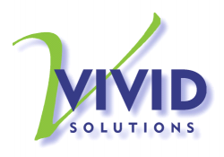
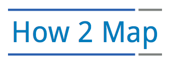
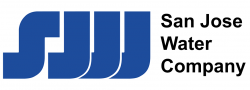
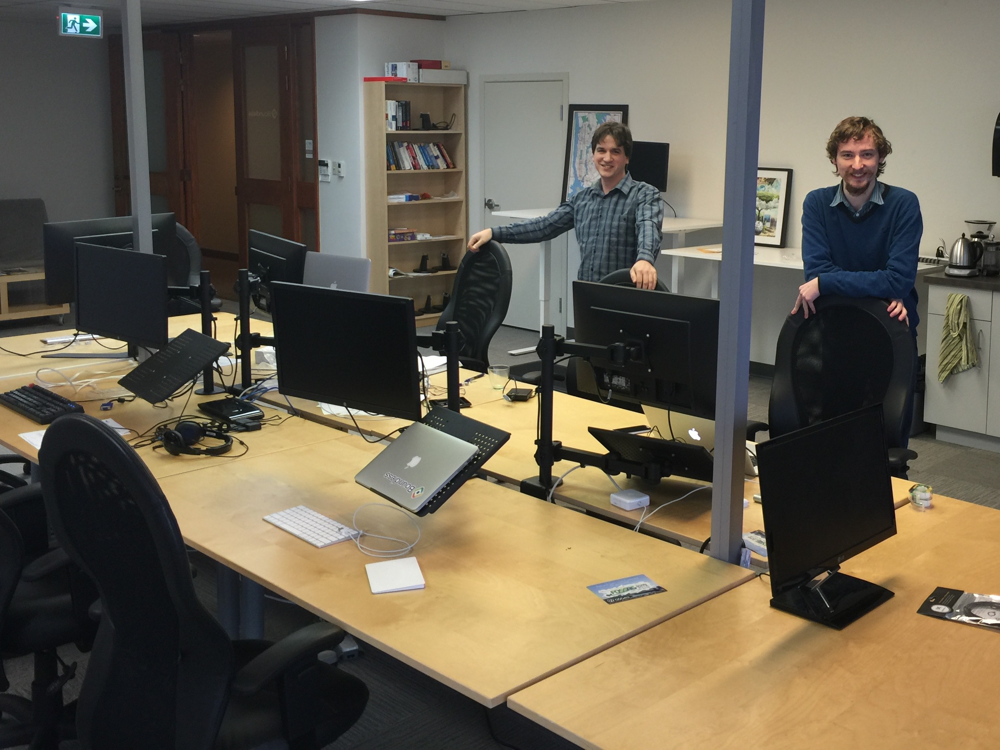
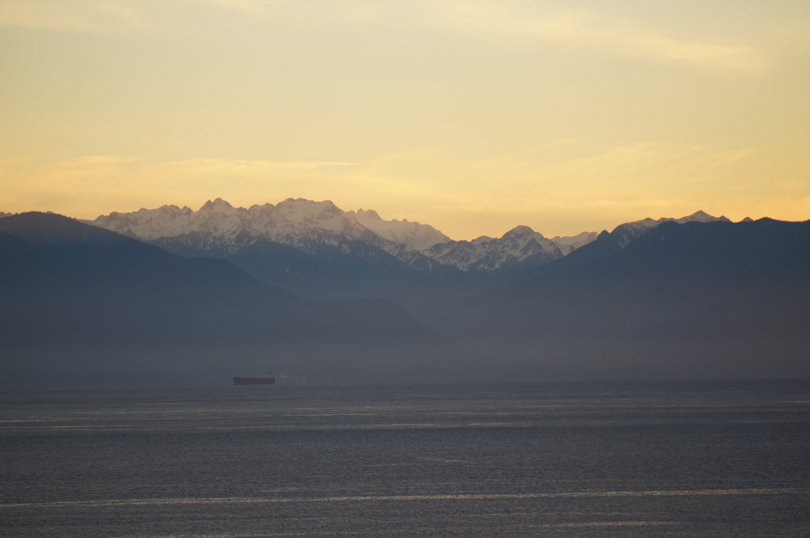
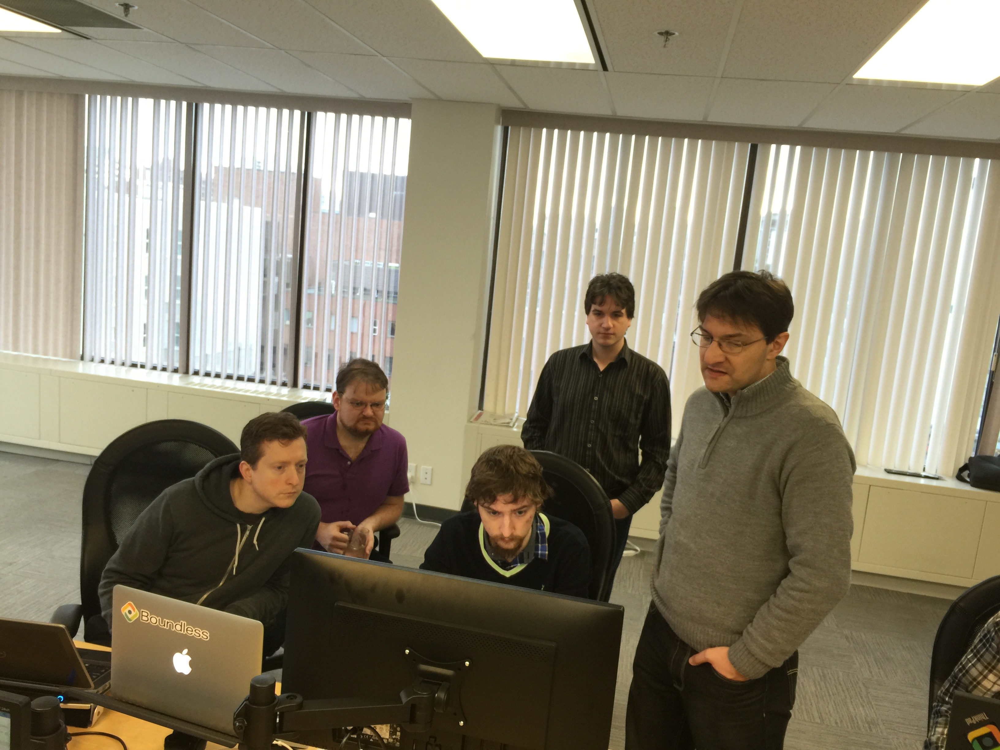

Follow up to our [GeoServer Code Sprint 2016]() post - we are all ready to go for next week!

	
  * Monday: Initial migration, Wicket 7 bootcamp / Java 8 bootcamp

	
  * Tuesday: Migration/testing workspace and datastore configuration

	
  * Wednesday: Migration/testing global, service and layer configuration

	
  * Thursday: Migration/testing tile cache, security and demos

	
  * Friday: demos, extensions and select community modules

Mike Pumphrey will be on hand to update the User Guide reference section and ask awkward questions about how things work. We expect to corner a few new volunteers for the scheduled release of GeoServer 2.8.2.

See the OSGeo [wiki page](https://wiki.osgeo.org/wiki/GeoServer_Code_Sprint_2016) for details, sponsors, participants and schedule. For participants (local and remote) there is a [pre-flight wiki page](https://github.com/geoserver/geoserver/wiki/Wicket-migration-code-sprint) with background reading for the upgrade.

## Thank you Sponsors

A big thanks to organizations sponsoring the sprint - you help make this gathering possible. Special thanks to the "In-Kind" sponsors sending staff to participate.

Gold Sponsors:

    

Silver Sponsors:

Bronze Sponsors:

     

In-Kind Sponsors:

    

## Welcome to Victoria

Thanks to Boundless Victoria for making their offices available (see prep below). We look forward to taking over next week and thanks to everyone for their hospitality.

